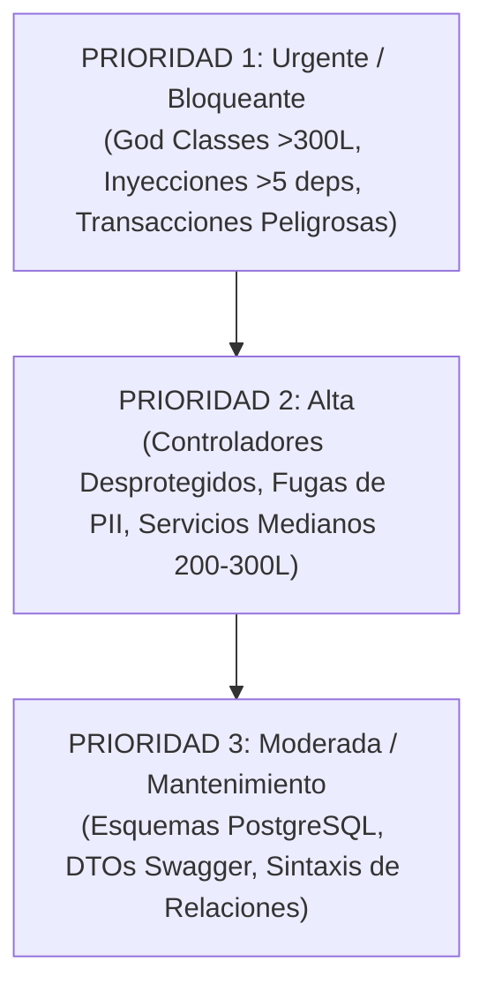

# Auditoría Integral de Arquitectura y Calidad de Código — SIS-SIRCA

**Documento Maestro de Evaluación Arquitectónica de los 26 Módulos del Backend**  
**Fecha de Publicación:** 27 de Octubre de 2026  
**Estándar de Evaluación:** `AGENTS.md` y `docs/architecture/GUIA_DESARROLLO_ARQUITECTURA.md`  
**Objetivo:** Diagnóstico exhaustivo de salud técnica, inventario de violaciones métricas y plan maestro de refactorización modular sin impacto regresivo.  
**Estado del Código en Producción:** Solo Lectura Estricta (`0` modificaciones en `src/`).

---

## 1. Executive Summary & Dashboard de Salud del Proyecto

### 1.1. Resumen Ejecutivo
Se ha llevado a cabo una auditoría arquitectónica profunda y sin precedentes sobre la totalidad de los **26 directorios de módulos** que integran el backend de **SIS-SIRCA** (`src/`). El análisis evaluó **392 archivos de código TypeScript/SQL**, totalizando aproximadamente **40,177 líneas de código**, contrastados sistemáticamente contra los límites métricos y principios de diseño consagrados en `AGENTS.md`.

> **Nota de Contexto del Árbol de Trabajo:** La presente auditoría evalúa exhaustivamente el estado activo del árbol de trabajo (*working tree*), incluyendo las modificaciones y adiciones de la rama activa de desarrollo médico/APS (`src/doctors/`, extensiones de consultas APS, DTOs y migraciones asociadas que totalizan 40 archivos modificados/sin seguimiento en git previos al inicio de la auditoría). Esta evaluación sobre el estado vivo garantiza una radiografía fiel y sin brechas de las funcionalidades en curso. Se certifica formalmente que durante el proceso de auditoría se mantuvo el principio de **cero modificaciones en `src/`** (confirmado mediante marcas de tiempo de modificación de archivos e inspección en modo solo lectura).

El diagnóstico global revela una arquitectura dividida en dos realidades:
1. **Infraestructura y Módulos de Soporte Modernos (Sanos):** Módulos como `common`, `config`, `system-settings`, `aws`, `pdf` y `assets` exhiben un apego sobresaliente a las directrices: tipado estricto sin `any`, uso de `AsyncLocalStorage` para contexto transaccional, decorador `@Transactional()`, `registerPostCommitHook()`, manejo semántico con `DomainException` y controladores ultradelgados.
2. **Dominios Centrales y Motores de Negocio (Deuda Técnica Crítica):** Los módulos nucleares de mayor impacto clínico y financiero (`eventualities`, `contracts`, `billing`, `reports`, `plans` y `chatbot`) sufrieron un crecimiento acelerado que derivó en la aparición de severas **"God Classes"**, servicios con miles de líneas (liderados por `eventualities.service.ts` con 2,192 líneas y `sip-commissions.service.ts` con 1,251 líneas), constructores con hasta 18 dependencias inyectadas, transacciones manuales con efectos secundarios externos (llamadas a WhatsApp y subidas a S3 dentro de transacciones de base de datos), desprotección de identificadores por omisión de `ParseUUIDPipe` y mezclas inapropiadas de lógica de presentación (ExcelJS y Puppeteer HTML) dentro de servicios de negocio.

### 1.2. Métricas Globales de Salud

```text
========================================================================================
 RESUMEN DE SALUD ARQUITECTÓNICA - SIS-SIRCA (26 MÓDULOS AUDITADOS)
========================================================================================
 Total Directorios / Módulos Auditados:        26
 Total Archivos Analizados:                    392 archivos
 Total Líneas de Código Analizadas:            ~40,177 líneas
 Archivos que Superan Límite Duro (>300L):     26 archivos (incluyendo 2 migraciones)
 Archivos en Zona de Alerta (250L - 300L):      6 archivos
 TOTAL ARCHIVOS AUDITADOS EXCEDIDOS (>250L):   32 archivos (detectados por audit:lines)
 Constructores con Infracción Crítica (>5):     8 clases / servicios (hasta 18 deps)
 Servicios con Límite de Inyecciones al Tope: 4 clases (5 dependencias)

 DISTRIBUCIÓN DE SALUD POR MÓDULOS:
 🔴 CRÍTICO (Requiere Refactor Inmediato):      6 módulos  (23.1%)
 🟡 ALERTA (Refactor Parcial / Mejoras):       14 módulos  (53.8%)
 🟢 CUMPLE (Saludable / Referencia Modelo):     6 módulos  (23.1%)
========================================================================================
```

### 1.3. Dashboard Consolidado de los 26 Módulos

| # | Módulo | Directorio | Archivos | Líneas | Files >250L | Files >300L | Infracción Deps (>5) | Estado | Hallazgo Arquitectónico Principal |
| :---: | :--- | :--- | :---: | :---: | :---: | :---: | :---: | :---: | :--- |
| 1 | **Eventualities** | `src/eventualities` | 29 | 5,439 | 4 | 3 | 1 (18 deps) | 🔴 **CRÍTICO** | God Class de 2,192L (`eventualities.service.ts`, 18 deps: 1 DataSource, 11 repositorios, 6 servicios); controlador monolítico 372L; WhatsApp dentro de transacciones; OCR 583L y PDF 475L con plantillas inline. |
| 2 | **Contracts** | `src/contracts` | 57 | 7,325 | 8 | 8 | 3 (hasta 9 deps) | 🔴 **CRÍTICO** | 7 servicios y 1 repositorio >300L; `contracts.service.ts` con 9 deps; 13 endpoints sin `ParseUUIDPipe`; método de 263L en verificación; spread `...dto`. |
| 3 | **Plans** | `src/plans` | 25 | 1,833 | 1 | 1 | 0 (1 con 5 deps) | 🔴 **CRÍTICO** | `plan-services.service.ts` de 405L; todos los controladores sin `ParseUUIDPipe`; spread de DTOs; entidades sin `decimalTransformer`. |
| 4 | **Billing** | `src/billing` | 51 | 6,850 | 4 | 4 | 3 (6 deps) | 🔴 **CRÍTICO** | 3 servicios >300L; cron `payment-pdf.cron.ts` (341L, 6 deps); transacciones manuales en crons; endpoints sin `ParseUUIDPipe`; inline types en `@Body()`. |
| 5 | **Reports** | `src/reports` | 15 | 4,680 | 6 | 5 | 0 (1 con 5 deps) | 🔴 **CRÍTICO** | God Class `sip-commissions.service.ts` (1,251L); 5 servicios >300L; acoplamiento masivo de ExcelJS y PDF en servicios de consulta; controlador de 223L. |
| 6 | **Chatbot** | `src/chatbot` | 35 | 3,309 | 4 | 2 | 1 (8 deps) | 🔴 **CRÍTICO** | `chatbot-payment.service.ts` (341L, 8 deps) con `queryRunner` manual y fuga de PII (cédulas) en logs; `meta-whatsapp.service.ts` (338L) con catch vacío; forwardRef circular. |
| 7 | **Doctors** | `src/doctors` | 6 | 534 | 1 | 0 | 0 | 🟡 **ALERTA** | `doctors.service.ts` (276L); controlador con `@Req() req: any`, `parseInt` manual y `throw new Error()` crudo; casteo `as any` en upload S3; sin `ParseUUIDPipe`. |
| 8 | **Persons** | `src/persons` | 9 | 856 | 0 | 0 | 0 | 🟡 **ALERTA** | `person-benefits.service.ts` (226L >200L); `create-person.dto.ts` (148L); endpoints `GET/DELETE :id` sin `ParseUUIDPipe`; listado `findAll` sin paginación. |
| 9 | **Cie10** | `src/cie10` | 4 | 229 | 0 | 0 | 0 | 🟡 **ALERTA** | Controlador con `parseInt` manual en query; servicio usa `Array<any>` para precarga; falta DTO de búsqueda. |
| 10 | **Advisors** | `src/advisors` | 6 | 216 | 0 | 0 | 0 | 🟡 **ALERTA** | Controlador sin `ParseUUIDPipe` en `:id`; listado sin paginación estándar; entidad sin restricción `@Check('commission >= 0')`. |
| 11 | **Portfolios** | `src/portfolios` | 6 | 228 | 0 | 0 | 0 | 🟡 **ALERTA** | Servicio con excepciones HTTP crudas y spread `...dto`; entidad con `commission_amount` sin `decimalTransformer`; controlador sin `ParseUUIDPipe`. |
| 12 | **Exchange-rate** | `src/exchange-rate` | 5 | 358 | 0 | 0 | 0 | 🟡 **ALERTA** | Nombre PascalCase `Exchange-rate.entity.ts`; PK `uuid` en vez de `id`; columnas sin `name: 'snake_case'` ni `decimalTransformer`; falta `@Check`; excepción HTTP cruda. |
| 13 | **Statistics** | `src/statistics` | 4 | 381 | 1 | 0 | 0 | 🟡 **ALERTA** | `statistics.service.ts` (283L) con 3 sentencias SQL CTE embebidas; controlador sin DTO de validación para `month_billing` y `advisor_uuid`. |
| 14 | **Auth** | `src/auth` | 11 | 355 | 0 | 0 | 0 | 🟡 **ALERTA** | Excepciones HTTP directas (`UnauthorizedException`) en servicio; DTO sin `@ApiProperty()` ni trim; relación en formato string en guard. |
| 15 | **Users** | `src/users` | 7 | 344 | 0 | 0 | 0 | 🟡 **ALERTA** | Spread de DTO `...dto` en creación; excepciones HTTP directas; `findAll` sin paginación; DTOs sin decoradores OpenAPI. |
| 16 | **Roles** | `src/roles` | 8 | 260 | 0 | 0 | 0 | 🟡 **ALERTA** | Excepciones HTTP en servicio; `assignPermissions` sin `@Transactional()`; relaciones string `['permissions']`; `findAll` sin paginar. |
| 17 | **Permissions** | `src/permissions` | 6 | 190 | 0 | 0 | 0 | 🟡 **ALERTA** | Excepciones HTTP en servicio; uso de método TypeORM obsoleto `findByIds()`; DTOs sin decoradores `@ApiProperty()`. |
| 18 | **Email** | `src/email` | 2 | 242 | 0 | 0 | 0 | 🟡 **ALERTA** | `email.service.ts` excede límite recomendado (233L); plantillas HTML inline embebidas en funciones del servicio. |
| 19 | **Ocr** | `src/ocr` | 2 | 257 | 0 | 0 | 0 | 🟡 **ALERTA** | `ocr.service.ts` (246L); prompt de OpenAI masivo de 97 líneas embebido en el método; falta resiliencia con `withRetry()`. |
| 20 | **Database** | `src/database` | 64 | 3,920 | 2 | 2 | 0 | 🟡 **ALERTA** | Deuda histórica: 2 migraciones >300L (`178577...` 347L y `179182...` 340L) y uso de `as any` en seeds JSON. Módulo core limpio (31L). Migraciones inmutables. |
| 21 | **Common** | `src/common` | 24 | 1,850 | 0 | 0 | 0 | 🟢 **CUMPLE** | Módulo modelo de infraestructura. Implementa ALS, `@Transactional()`, `registerPostCommitHook`, filtros globales, `DomainException`, cero `any`. |
| 22 | **Config** | `src/config` | 3 | 106 | 0 | 0 | 0 | 🟢 **CUMPLE** | Configuración modular limpia mediante `registerAs`, tipado estricto `ConfigType`, integración TypeORM desacoplada. |
| 23 | **System-settings** | `src/system-settings` | 7 | 373 | 0 | 0 | 0 | 🟢 **CUMPLE** | Módulo modelo. Respeta todos los límites: servicio 105L (1 dep), controlador 28L, uso estricto de `EntityNotFoundException`, caché en memoria. |
| 24 | **Aws** | `src/aws` | 3 | 110 | 0 | 0 | 0 | 🟢 **CUMPLE** | Módulo modelo de integración: servicio 72L (1 dep), controlador 29L, resiliencia con `withRetry()`, excepciones envueltas en `ExternalServiceException`. |
| 25 | **Pdf** | `src/pdf` | 2 | 142 | 0 | 0 | 0 | 🟢 **CUMPLE** | Servicio 133L (0 deps), manejo seguro del ciclo de vida de Chromium con `try/finally` para evitar fugas de memoria. |
| 26 | **Assets** | `src/assets` | 1 | - | 0 | 0 | 0 | 🟢 **CUMPLE** | Directorio estático de imágenes corporativas (`logo.png`), sin código ejecutable ni dependencias. |
| - | **TOTALES CONSOLIDADOS** | **26 Módulos** | **392** | **40,177** | **32** | **26** | **8** | **6 🔴 / 14 🟡 / 6 🟢** | **32 archivos superan los límites de código.** |

*Nota sobre el Árbol de Trabajo:* El análisis métrico consolida el estado activo del árbol de trabajo local (incluyendo 40 archivos preexistentes en `src/` del subsistema APS/Doctors). La auditoría se ejecutó en estricto modo de solo lectura sobre `src/`, garantizando 0 modificaciones en el código fuente.

---

## 2. Contabilización y Mapeo Completo de los Archivos Críticos (>250 líneas)

El script de auditoría automatizada del repositorio (`node script/audit-code-quality.cjs` / `npm run audit:lines`) detectó **32 archivos** que exceden el límite de alerta (250 líneas) y el límite duro (300 líneas). 

A continuación se presenta el mapeo exhaustivo de los 32 archivos, su conteo exacto de líneas, conteo de inyecciones, responsabilidades acopladas y los archivos destino propuestos para su descomposición modular:

| # | Archivo Excedido | Módulo | Líneas | Deps Ctor | Clasificación | Responsabilidades Actuales Acopladas | Archivos y Sub-servicios Destino Propuestos |
| :---: | :--- | :--- | :---: | :---: | :---: | :--- | :--- |
| 0 | `src/eventualities/services/eventualities.service.ts` | `eventualities` | **2,192** | 18 | 🔴 **CRÍTICO** | God Class: admisión de emergencias, aprobación/rechazo, consultas APS, hojas de consumo, baremos, facturas de proveedores, órdenes de servicio, WhatsApp y recálculo BCV. 18 deps en constructor (1 DataSource, 11 repositorios, 6 servicios). | 9 sub-servicios especializados inyectados directamente en 4 controladores segregados (<=3 deps); cualquier fachada de compatibilidad residual dividida en sub-fachadas para garantizar estrictamente <=4 deps por clase. |
| 1 | `src/reports/sip-commissions.service.ts` | `reports` | **1,251** | 3 | 🔴 **CRÍTICO** | God Class: consultas SQL CTE con 6 tablas, agrupaciones por asesor/cartera, maquetación y estilizado masivo en celdas de ExcelJS (650L) y generación de PDF HTML. | `sip-commissions.service.ts` (~200L), generador Excel modularizado (`excel.builder.ts` ~150L, `styles.helper.ts` ~150L, `writer.helper.ts` ~250L para evitar God Helpers), `pdf.builder.ts` (~100L), `aggregator.helper.ts` (~160L pura). |
| 2 | `src/contracts/services/contract-affiliation.service.ts` | `contracts` | **632** | 6 | 🔴 **CRÍTICO** | Afiliación de personas, desincorporación, cambio de titularidad, asignación de responsable de pago, recálculo de cuotas y actualización masiva de beneficiarios. | `contract-beneficiary.service.ts` (~180L, <=4 deps), `contract-titular-billing.service.ts` (~120L, <=3 deps), `contract-pricing.helper.ts` (función pura). |
| 3 | `src/eventualities/services/eventuality-ocr.service.ts` | `eventualities` | **583** | 1 | 🔴 **CRÍTICO** | Prompts OpenAI extensos, esquemas JSON y parsing para 3 tipos de documentos: informes médicos, hojas de consumo clínico y facturas fiscales. | `medical-report-ocr.helper.ts`, `consumption-sheet-ocr.helper.ts`, `provider-invoice-ocr.helper.ts` (helpers puros) + servicio orquestador delgado (~140L). |
| 4 | `src/reports/advisor-payments.service.ts` | `reports` | **564** | 2 | 🔴 **CRÍTICO** | Consulta de comisiones liquidadas por asesor, maquetación programática de ExcelJS con paleta corporativa y renderizado de PDF HTML. | `advisor-payments.service.ts` (~140L), `advisor-payments-excel.builder.ts` (~320L), `advisor-payments-pdf.builder.ts` (~100L). |
| 5 | `src/contracts/services/contract-verification.service.ts` | `contracts` | **562** | 2 | 🔴 **CRÍTICO** | Verificación integral de asegurados; el método `verifyPersonAffiliation` tiene 263 líneas por sí solo, mezclando queries de BD con reglas de carencia y estados de deuda. | `contract-verification.helper.ts` (~150L pura) para evaluación de reglas de negocio + servicio orquestador (~130L). |
| 6 | `src/eventualities/services/eventuality-pdf.service.ts` | `eventualities` | **475** | 2 | 🔴 **CRÍTICO** | Orquestación de datos combinada con plantillas HTML/CSS masivas declaradas como strings inline para comprobantes de siniestro, informes y récipes. | Helpers de plantillas HTML puros: `voucher-pdf-template.helper.ts`, `medical-report-pdf-template.helper.ts`, `prescription-pdf-template.helper.ts` + servicio (~120L). |
| 7 | `src/billing/invoices/services/invoice-line.service.ts` | `billing` | **459** | 5 | 🔴 **CRÍTICO** | Gestión de cargos adicionales manuales mezclada con recálculos automáticos de líneas por desafiliación o cambio de plan de beneficiarios en contratos. | `invoice-line.service.ts` (Fachada ~60L), `invoice-additional-charge.service.ts` (~150L), `invoice-affiliate-line.service.ts` (~230L). |
| 8 | `src/contracts/services/contract-lifecycle.service.ts` | `contracts` | **450** | 5 | 🔴 **CRÍTICO** | Operaciones CRUD básicas mezcladas con transiciones de estado de alta complejidad (activación, renovación, suspensión, inactivación y sincronización de carencia). | `contract-state.service.ts` (~150L, <=3 deps) para transiciones formales + `contract-crud.service.ts` (~120L, <=2 deps) para operaciones directas. |
| 9 | `src/contracts/services/contract-pdf.service.ts` | `contracts` | **450** | 3 | 🔴 **CRÍTICO** | Construcción de contratos impresos con plantillas HTML/CSS extensas inline, agregación de beneficiarios y despacho a S3. | `contract-pdf-template.helper.ts` (~220L pura) para armado de HTML + servicio de consulta y subida (~120L). |
| 10 | `src/reports/projection-report.service.ts` | `reports` | **442** | 2 | 🔴 **CRÍTICO** | Proyecciones financieras de ingresos futuros por cartera mezcladas con código visual de hojas de cálculo ExcelJS y generación PDF. | `projection-report.service.ts` (~130L), `projection-report-excel.builder.ts` (~240L), `projection-report-pdf.builder.ts` (~80L). |
| 11 | `src/reports/affiliations-report.service.ts` | `reports` | **434** | 2 | 🔴 **CRÍTICO** | Consultas agregadas de altas y bajas de afiliados con maquetación de reportes ExcelJS multipestaña y PDFs corporativos. | `affiliations-report.service.ts` (~140L), `affiliations-report-excel.builder.ts` (~220L), `affiliations-report-pdf.builder.ts` (~80L). |
| 12 | `src/plans/services/plan-services.service.ts` | `plans` | **405** | 5 | 🔴 **CRÍTICO** | Baremos de costos, factores globales de ganancia, validación de reglas de límites (`UNLIMITED`, `MONTHLY`, `ANNUAL`) y creación por lotes. | `plan-services.service.ts` (~160L, <=3 deps) + `plan-pricing.helper.ts` (funciones puras: `resolveServicePricing`, `validateLimits`, `groupServicesByCategory`). |
| 13 | `src/contracts/repositories/contract-query.repository.ts` | `contracts` | **375** | 1 | 🔴 **CRÍTICO** | Múltiples QueryBuilders dinámicos para consulta de contratos, renovaciones y pipeline comercial en un solo archivo de repositorio. | Separar constructores de filtros a `contract-filter.builder.ts` y sub-repositorios para pipeline y renovaciones. |
| 14 | `src/eventualities/controllers/eventualities.controller.ts` | `eventualities` | **372** | 3 | 🔴 **CRÍTICO** | Monolito de más de 25 endpoints: admisiones, triaje médico, consultas, descargas de PDF, carga de facturas y hojas de consumo. | Segregar en 4 controladores por sub-recurso (`eventualities.controller.ts`, `eventuality-doctor`, `eventuality-document`, `eventuality-billing`) con `@Controller('eventualities')`. |
| 15 | `src/billing/payments/services/payment-creation.service.ts` | `billing` | **364** | 6 | 🔴 **CRÍTICO** | Validación de montos, resolución de tasas BCV, bloqueo pesimista determinista en facturas, imputación en cascada y excedentes (6 deps). | `payment-creation.service.ts` (~160L, 4 deps) para validación y persistencia + `payment-allocation.service.ts` (~180L, 2 deps) para imputación en cascada. |
| 16 | `src/billing/payments/services/surplus.service.ts` | `billing` | **364** | 4 | 🔴 **CRÍTICO** | Imputación automática de excedentes en facturas nuevas vía `@OnEvent` mezclada con transiciones administrativas (cancelación/reembolso). | `surplus.service.ts` (~220L, 3 deps) para imputación y listener + `surplus-state.service.ts` (~130L, 2 deps) para ciclo de vida manual. |
| 17 | `src/contracts/services/coverage-period.service.ts` | `contracts` | **352** | 2 | 🔴 **CRÍTICO** | Gestión de períodos anuales, retención preventiva de coberturas, ajuste de reservas de siniestros y fórmulas de balance financiero. | `coverage-period.service.ts` (~140L) centrado en persistencia con `@Transactional()` + `coverage-period-calculator.helper.ts` (~90L pura). |
| 18 | `src/database/migrations/1785772502775-OptimizeDatabaseIndexesAndTimestamps.ts` | `database` | **347** | 0 | 🔴 **CRÍTICO** | Migración histórica masiva con creación de decenas de índices y ajustes de timestamps en PostgreSQL. | **Inmutable:** Archivo histórico ejecutado. No alterar para preservar la integridad de la tabla `migrations` y checksums de despliegue. |
| 19 | `src/billing/crons/payment-pdf.cron.ts` | `billing` | **341** | 6 | 🔴 **CRÍTICO** | Cron pesado con 6 deps: renderiza PDFs multipágina, sube a S3, despacha correos vía SES y actualiza registros de pago en base de datos. | `payment-pdf.cron.ts` (cron delgado ~45L, 1 dep) + `payment-receipt-batch.service.ts` (~180L, <=4 deps), delegando formato y opciones PDF a helpers puros. |
| 20 | `src/chatbot/services/chatbot-payment.service.ts` | `chatbot` | **341** | 8 | 🔴 **CRÍTICO** | 8 deps en constructor, transacciones manuales `queryRunner`, cálculo de prorrateo Zelle/Bs, parsing OCR, envíos a WhatsApp y logs con cédulas en plano (PII). | `chatbot-payment.service.ts` (~110L, 4 deps), `chatbot-post-payment.service.ts` (~115L, 4 deps), `chatbot-payment-calculator.helper.ts` (~60L), `chatbot-payment-message.helper.ts` (~65L). |
| 21 | `src/database/migrations/1791825184031-CreateEmergencyEventualitiesTables.ts` | `database` | **340** | 0 | 🔴 **CRÍTICO** | Migración histórica masiva que define las tablas principales del subsistema de siniestros médicos. | **Inmutable:** Archivo histórico ejecutado. Preservar sin cambios. |
| 22 | `src/contracts/services/contract-creation.service.ts` | `contracts` | **339** | 7 | 🔴 **CRÍTICO** | 7 dependencias inyectadas; acoplamiento con emisión de facturas, exclusiones médicas y PDF; spread `...contractData` sobre DTO. | Reducir dependencias a <=4 desacoplando exclusiones y PDF vía eventos; reemplazar spread por asignación explícita (~190L). |
| 23 | `src/chatbot/services/meta-whatsapp.service.ts` | `chatbot` | **338** | 1 | 🔴 **CRÍTICO** | Construcción de payloads anidados JSON de Meta Graph API (flows, botones, templates, fallbacks) mezclada con cliente HTTP Axios; catch vacío. | `meta-whatsapp.service.ts` (~115L) con `withRetry()` y manejo de errores + `meta-payload-builder.helper.ts` (~160L pura). |
| 24 | `src/contracts/services/health-exclusions.service.ts` | `contracts` | **328** | 3 | 🔴 **CRÍTICO** | Evaluación de cuestionarios de salud, análisis de preexistencias y mapeo de diagnósticos CIE-10 a exclusiones por plan. | `health-exclusions.service.ts` (~140L) + `health-exclusion-evaluator.helper.ts` (~160L funciones puras con TDD). |
| 25 | `src/reports/reports.service.ts` | `reports` | **325** | 2 | 🔴 **CRÍTICO** | Servicio de reporte de detalle de contratos con nombre genérico confuso, acoplando consultas SQL con maquetación de ExcelJS y PDF. | Renombrar a `contract-detail-report.service.ts` (~130L), `contract-detail-excel.builder.ts` (~150L), `contract-detail-pdf.builder.ts` (~60L). |
| 26 | `src/statistics/services/statistics.service.ts` | `statistics` | **283** | 1 | 🟡 **ALERTA** | Contiene 3 sentencias SQL CTE complejas incrustadas junto con la agregación y formateo de métricas financieras. | `statistics.service.ts` (~120L) enfocado en orquestación + `statistics-query.repository.ts` (~160L) para consultas SQL. |
| 27 | `src/chatbot/services/chatbot.service.ts` | `chatbot` | **281** | 4 | 🟡 **ALERTA** | Orquestador de webhooks que alberga lógica de negocio de aprobación clínica de siniestros (`forwardRef` circular con `EventualitiesService`). | `chatbot.service.ts` (~190L) + desacoplamiento vía `EventEmitter2` o módulo neutral de notificaciones, eliminando importación circular entre módulos. |
| 28 | `src/billing/invoices/services/invoice.service.ts` | `billing` | **280** | 6 | 🔴 **CRÍTICO** (Deps) | Fachada que viola el límite de dependencias (6 deps) al mantener repositorios TypeORM y consultas directas en lugar de delegar en QueryRepository. | Mover consultas a `InvoiceQueryRepository`, reducir inyecciones de 6 a 4 y reducir tamaño a ~90L de fachada pura. |
| 29 | `src/doctors/doctors.service.ts` | `doctors` | **276** | 3 | 🟡 **ALERTA** | CRUD médico mezclado con decodificación de firmas digitales base64, manipulación de streams y subida síncrona a AWS S3 con casteo `as any`. | `doctors.service.ts` (~180L) + `doctor-signature.service.ts` (~80L) o helper de firmas tipado sin `any`. |
| 30 | `src/chatbot/services/reminder.service.ts` | `chatbot` | **273** | 4 | 🟡 **ALERTA** | Crons de recordatorio mezclados con helpers puros de formateo de moneda, meses en español, enmascaramiento telefónico y agregación de deuda. | `reminder.service.ts` (~145L) enfocado en scheduler + `reminder.helper.ts` (~110L funciones puras). |
| 31 | `src/reports/report-utils.ts` | `reports` | **263** | 0 | 🟡 **ALERTA** | Archivo de utilidades que aglutina helpers heterogéneos de diseño de tablas, estilos de celda Excel, formateo de números y fechas. | Dividir en helpers cohesivos: `excel-styler.util.ts` (~120L), `report-number-formatter.util.ts` (~80L), `report-date.util.ts` (~60L). |

---

## 3. Detalle Exhaustivo de Auditoría Módulo por Módulo (Los 26 Directorios)

A continuación se detalla la auditoría individual para cada uno de los 26 directorios bajo `src/`, ordenados alfabéticamente para facilitar la navegación y consulta técnica.

---

### 3.1. Módulo `advisors` (Asesores Comerciales)
- **Directorio:** `src/advisors`
- **Estado de Salud:** 🟡 **ALERTA (Refactor Parcial / Mejoras Moderadas)**
- **Métricas:** 6 archivos, 216 líneas totales.

#### A. Componentes y Archivos Clave
| Archivo | Tipo | Líneas | Inyecciones Ctor | Estado |
| :--- | :--- | :---: | :---: | :---: |
| `advisors.controller.ts` | Controlador | 47 | 1 dep | 🟢 CUMPLE |
| `advisors.service.ts` | Servicio | 68 | 1 dep | 🟢 CUMPLE |
| `advisors.module.ts` | Módulo | 14 | 0 | 🟢 CUMPLE |
| `dto/create-advisor.dto.ts` | DTO | 18 | 0 | 🟢 CUMPLE |
| `dto/update-advisor.dto.ts` | DTO | 5 | 0 | 🟢 CUMPLE |
| `entities/advisor.entity.ts` | Entidad | 64 | 0 | 🟢 CUMPLE |

#### B. Conteo de Dependencias en `@Injectable()`
- `AdvisorsService`: 1 dependencia (`@InjectRepository(Advisor) private readonly advisorRepository: Repository<Advisor>`). Cumple holgadamente.

#### C. Evaluación de las 5 Dimensiones
1. **Tamaño y SRP:** Archivos extraordinariamente concisos y enfocados en el CRUD de asesores. Cumplimiento total de límites de líneas.
2. **Transacciones y Efectos Secundarios:** Operaciones directas de repositorio simples. No requiere transaccionalidad distribuida.
3. **Manejo de Errores:** Ejemplar: utiliza `EntityNotFoundException('Asesor', id)` de `src/common/exceptions`.
4. **Diseño API REST:** 🟡 En `advisors.controller.ts`, los endpoints `GET :id`, `PATCH :id` y `DELETE :id` (líneas 31, 37, 43) carecen de `ParseUUIDPipe`. `findAll()` retorna el array completo sin soporte de `PaginationQueryDto`.
5. **Tipado TypeScript y Esquema PostgreSQL:** Entidad utiliza `timestamptz` y `decimalTransformer` en la columna `commission`. Falta agregar la restricción a nivel BD `@Check('CHK_advisors_commission', 'commission >= 0')`.

#### D. Plan de Descomposición / Remediación
- Agregar `ParseUUIDPipe` en las rutas del controlador.
- Implementar `FindAdvisorsDto` extendiendo de `PaginationQueryDto` para el método `findAll()`.
- Crear migración para agregar la restricción `@Check` de comisión no negativa.

---

### 3.2. Módulo `assets` (Recursos Estáticos)
- **Directorio:** `src/assets`
- **Estado de Salud:** 🟢 **CUMPLE (Saludable)**
- **Métricas:** 1 archivo (`images/logo.png`), 0 líneas de código TypeScript.

#### A. Evaluación de las 5 Dimensiones
1. **Tamaño y SRP:** Contiene exclusivamente activos gráficos estáticos utilizados para la generación de reportes PDF y Excel institucionales.
2. **Transacciones, Errores, API REST, Tipado/BD:** No aplica. No contiene lógica ejecutable ni servicios.

---

### 3.3. Módulo `auth` (Autenticación y Seguridad)
- **Directorio:** `src/auth`
- **Estado de Salud:** 🟡 **ALERTA (Refactor Parcial / Mejoras Moderadas)**
- **Métricas:** 11 archivos, 355 líneas totales.

#### A. Componentes y Archivos Clave
| Archivo | Tipo | Líneas | Inyecciones Ctor | Estado |
| :--- | :--- | :---: | :---: | :---: |
| `auth.controller.ts` | Controlador | 51 | 1 dep | 🟢 CUMPLE |
| `auth.service.ts` | Servicio | 69 | 2 deps | 🟡 ALERTA (Excepciones HTTP) |
| `auth.module.ts` | Módulo | 46 | 0 | 🟢 CUMPLE |
| `dto/login.dto.ts` | DTO | 13 | 0 | 🟡 ALERTA (Sin Swagger) |
| `guards/auth.guard.ts` | Guard | 61 | 2 deps | 🟢 CUMPLE |
| `guards/permissions.guard.ts` | Guard | 71 | 2 deps | 🟡 ALERTA (Relación string) |

#### B. Conteo de Dependencias en `@Injectable()`
- `AuthService`: 2 dependencias (`UsersService`, `JwtService`). Cumple.
- `AuthGuard`: 2 dependencias (`JwtService`, `Reflector`). Cumple.
- `PermissionsGuard`: 2 dependencias (`Reflector`, `@InjectRepository(Role)`). Cumple.

#### C. Evaluación de las 5 Dimensiones
1. **Tamaño y SRP:** Todos los archivos por debajo de 75 líneas.
2. **Transacciones y Efectos Secundarios:** Lectura e intercambio criptográfico de tokens JWT; `AuthGuard` registra el usuario en `AsyncLocalStorage` (`setContextUser(payload)` en línea 48), garantizando el desacoplamiento de `@Inject(REQUEST)`.
3. **Manejo de Errores:** 🟡 En `auth.service.ts` (líneas 23, 28, 34), se lanzan directamente `UnauthorizedException` de NestJS en lugar de utilizar `UnauthorizedDomainException` de `src/common/exceptions`.
4. **Diseño API REST:** `LoginDto` carece de decoradores OpenAPI (`@ApiProperty()`) y de sanitización con `@Transform(({ value }) => value?.trim().toLowerCase())`.
5. **Tipado TypeScript y Esquema PostgreSQL:** 0 tipos `any`. En `permissions.guard.ts` (línea 50), se utiliza la sintaxis heredada de array de strings `relations: ['permissions']` en lugar del objeto `relations: { permissions: true }`.

#### D. Plan de Descomposición / Remediación
- Reemplazar `UnauthorizedException` por `UnauthorizedDomainException(ErrorCode.INVALID_CREDENTIALS, ...)`.
- Incorporar `@ApiProperty()` y `@Transform` en `LoginDto`.
- Migrar relación en `permissions.guard.ts` a sintaxis de objeto TypeORM.

---

### 3.4. Módulo `aws` (Integración Amazon Web Services)
- **Directorio:** `src/aws`
- **Estado de Salud:** 🟢 **CUMPLE (Saludable - Módulo de Referencia)**
- **Métricas:** 3 archivos, 110 líneas totales.

#### A. Componentes y Archivos Clave
| Archivo | Tipo | Líneas | Inyecciones Ctor | Estado |
| :--- | :--- | :---: | :---: | :---: |
| `controllers/aws.controller.ts` | Controlador | 29 | 1 dep | 🟢 CUMPLE |
| `aws.service.ts` | Servicio | 72 | 1 dep | 🟢 CUMPLE |
| `aws.module.ts` | Módulo | 9 | 0 | 🟢 CUMPLE |

#### B. Conteo de Dependencias en `@Injectable()`
- `AwsService`: 1 dependencia (`ConfigService`). Cumple.
- `AwsController`: 1 dependencia (`AwsService`). Cumple.

#### C. Evaluación de las 5 Dimensiones
1. **Tamaño y SRP:** Archivos ultra compactos (servicio de 72L y controlador de 29L).
2. **Transacciones y Efectos Secundarios:** Desacoplado de base de datos; implementa resiliencia en la subida a S3 mediante reintentos exponenciales con `withRetry()`.
3. **Manejo de Errores:** 🟢 Impecable: captura excepciones de S3 y las envuelve en `ExternalServiceException('AWS S3', ..., ErrorCode.AWS_S3_ERROR, error)`.
4. **Diseño API REST:** Controlador limpio con `@UseInterceptors(FileInterceptor('file'))`.
5. **Tipado TypeScript y Esquema PostgreSQL:** Tipado estricto `Express.Multer.File`, sin `any`.

---

### 3.5. Módulo `billing` (Facturación y Pagos)
- **Directorio:** `src/billing`
- **Estado de Salud:** 🔴 **CRÍTICO (Requiere Refactor Inmediato)**
- **Métricas:** 51 archivos, 6,850 líneas totales.

#### A. Componentes y Archivos Clave
| Archivo | Tipo | Líneas | Inyecciones Ctor | Estado |
| :--- | :--- | :---: | :---: | :---: |
| `invoices/services/invoice-line.service.ts` | Servicio | **459** | 5 deps | 🔴 CRÍTICO (>300L) |
| `invoices/services/invoice.service.ts` | Servicio (Facade) | **280** | **6 deps** | 🔴 CRÍTICO (>5 deps, >200L) |
| `invoices/services/invoice-generation.service.ts` | Servicio | **248** | 4 deps | 🟡 ALERTA (>200L) |
| `invoices/services/invoice-calculation.service.ts` | Servicio | **228** | 4 deps | 🟡 ALERTA (>200L) |
| `payments/services/payment-creation.service.ts` | Servicio | **364** | **6 deps** | 🔴 CRÍTICO (>300L, >5 deps) |
| `payments/services/surplus.service.ts` | Servicio | **364** | 4 deps | 🔴 CRÍTICO (>300L) |
| `crons/payment-pdf.cron.ts` | Cron | **341** | **6 deps** | 🔴 CRÍTICO (>300L, >5 deps) |
| `crons/generate-monthly-invoices.cron.ts` | Cron | 139 | 3 deps | 🟢 CUMPLE líneas / 🔴 Transaccionalidad |
| `payments/controllers/payments-billing.controller.ts` | Controlador | **194** | 3 deps | 🟡 ALERTA (>150L) |
| `invoices/entities/invoice.entity.ts` | Entidad | 120 | 0 | 🟢 CUMPLE |
| `invoices/entities/invoice-line.entity.ts` | Entidad | 76 | 0 | 🟡 ALERTA (Falta transformer) |
| `payments/entities/payment.entity.ts` | Entidad | 141 | 0 | 🟢 CUMPLE |
| `payments/entities/surplus.entity.ts` | Entidad | 130 | 0 | 🟢 CUMPLE |

#### B. Conteo de Dependencias en `@Injectable()`
- `InvoiceService`: **6 dependencias** (`invoiceRepository`, `dataSource`, `generationService`, `calculationService`, `lineService`, `pdfService`). Infracción crítica.
- `PaymentCreationService`: **6 dependencias** (`paymentRepository`, `dataSource`, `exchangeRateService`, `invoiceService`, `surplusService`, `contractsService`). Infracción crítica.
- `PaymentPdfCron`: **6 dependencias** (`paymentService`, `pdfService`, `emailService`, `awsService`, `exchangeRateService`, `configService`). Infracción crítica.
- `InvoiceLineService`: **5 dependencias** (`invoiceRepository`, `invoiceLineRepository`, `dataSource`, `queryRepo`, `calculationService`). Límite duro.

#### C. Evaluación de las 5 Dimensiones
1. **Tamaño y SRP:** 3 servicios (`invoice-line`, `payment-creation`, `surplus`) y 1 cron (`payment-pdf.cron`) superan las 300 líneas. Mezcla de cargos adicionales con alteraciones de afiliados; cron que construye PDFs y despacha emails directamente.
2. **Transacciones y Efectos Secundarios:** 🔴 `generate-monthly-invoices.cron.ts` usa `this.dataSource.createQueryRunner()` manual en lugar de `@Transactional()`. Por otro lado, `InvoiceGenerationService` implementa `registerPostCommitHook()` correctamente para emitir `INVOICE_CREATED`.
3. **Manejo de Errores:** Múltiples servicios lanzan `BadRequestException` y `NotFoundException` HTTP en vez de `EntityNotFoundException` o `InvalidDomainOperationException`.
4. **Diseño API REST:** 🔴 `PaymentsBillingController` tiene endpoints sin `ParseUUIDPipe` (`approvePayment`, `rejectPayment`, `updatePaymentDate`), usa inline types anónimos (`@Body() body: { reason?: string }`) y paginación con parseo manual `Number(page)`. `InvoiceBillingController` y `InvoiceController` carecen de `ParseUUIDPipe` en todos los parámetros `:id` / `:contractId`.
5. **Tipado TypeScript y Esquema PostgreSQL:** Tipado TS estricto (0 `any`, 0 spreads de DTO). En base de datos: `invoice-line.entity.ts` tiene columna `amount` (`type: 'decimal'`) **sin `transformer: decimalTransformer`**. Entidades `Payment` y `Surplus` carecen de `@Check` para montos no negativos.

#### D. Plan de Descomposición / Remediación
1. **Dividir `invoice-line.service.ts` (459L)** en `invoice-line.service.ts` (Fachada ~60L), `invoice-additional-charge.service.ts` (~150L) e `invoice-affiliate-line.service.ts` (~230L).
2. **Dividir `payment-creation.service.ts` (364L, 6 deps)** en `payment-creation.service.ts` (~160L, 4 deps) y `payment-allocation.service.ts` (~180L, 2 deps) para imputación pesimista en facturas.
3. **Dividir `surplus.service.ts` (364L)** en `surplus.service.ts` (~220L) y `surplus-state.service.ts` (~130L).
4. **Extraer `PaymentReceiptBatchService` (~180L, <=4 deps)** desde `payment-pdf.cron.ts`, asegurando un presupuesto estricto de `<=4` dependencias al delegar el formato del recibo y las opciones de renderizado PDF a helpers puros (`receipt-formatter.helper.ts` y `receipt-pdf-options.helper.ts`), reduciendo el cron a un scheduler delgado de ~45L con 1 dependencia.
5. **Reducir dependencias de `InvoiceService`** de 6 a 4 moviendo métodos de consulta a `InvoiceQueryRepository`.
6. **Corregir controladores**: Agregar `ParseUUIDPipe`, crear DTOs de clase formales para pagos y agregar `decimalTransformer` en `InvoiceLine`.

---

### 3.6. Módulo `chatbot` (Asistente Omnicanal WhatsApp)
- **Directorio:** `src/chatbot`
- **Estado de Salud:** 🔴 **CRÍTICO (Requiere Refactor Inmediato)**
- **Métricas:** 35 archivos, 3,309 líneas totales.

#### A. Componentes y Archivos Clave
| Archivo | Tipo | Líneas | Inyecciones Ctor | Estado |
| :--- | :--- | :---: | :---: | :---: |
| `services/chatbot-payment.service.ts` | Servicio | **341** | **8 deps** | 🔴 CRÍTICO (>300L, >5 deps) |
| `services/meta-whatsapp.service.ts` | Servicio | **338** | 1 dep | 🔴 CRÍTICO (>300L) |
| `services/chatbot.service.ts` | Servicio | **281** | 4 deps | 🟡 ALERTA (>250L) |
| `services/reminder.service.ts` | Servicio | **273** | 4 deps | 🟡 ALERTA (>250L) |
| `services/chatbot-analytics.service.ts` | Servicio | 195 | 2 deps | 🟢 CUMPLE |
| `services/meta-flow.service.ts` | Servicio | 139 | 2 deps | 🟢 CUMPLE |
| `chatbot.controller.ts` | Controlador | 91 | 3 deps | 🟢 CUMPLE |
| `chatbot-analytics.controller.ts` | Controlador | 29 | 1 dep | 🟢 CUMPLE |
| `entities/chatbot-interaction.entity.ts` | Entidad | 56 | 0 | 🟡 ALERTA (Faltan FK constraints) |

#### B. Conteo de Dependencias en `@Injectable()`
- `ChatbotPaymentService`: **8 dependencias** (`dataSource`, `personsService`, `metaWhatsappService`, `stateService`, `analyticsService`, `exchangeRateService`, `invoiceService`, `paymentService`). Infracción crítica severa; una de las mayores sobrecargas de inyección del backend, únicamente superada por `EventualitiesService` (18 dependencias) y `ContractsService` (9 dependencias).
- `ChatbotService`: 4 dependencias (incluye `forwardRef(() => EventualitiesService)`).
- `ReminderService`: 4 dependencias.
- Resto de servicios y steps: <=4 dependencias.

#### C. Evaluación de las 5 Dimensiones
1. **Tamaño y SRP:** 2 servicios superan las 300L (`chatbot-payment.service.ts` y `meta-whatsapp.service.ts`) y 2 superan las 250L (`chatbot.service.ts` y `reminder.service.ts`). Mezcla de prorrateo matemático, manipulación de esquemas JSON de Meta y despachos HTTP.
2. **Transacciones y Efectos Secundarios:** 🔴 `ChatbotPaymentService` gestiona transacciones con `queryRunner` manual y, dentro del bloque `catch` de fallo transaccional, ejecuta llamadas a la API de WhatsApp sin `registerPostCommitHook()`.
3. **Manejo de Errores y Privacidad PHI/PII:** 🔴 En `chatbot-payment.service.ts` (líneas 92-94) se registra la cédula completa en texto plano en los logs de producción (`this.logger.warn(...)`), violando la directriz Cero-PII. En `meta-whatsapp.service.ts` (línea 310) hay un bloque `catch {}` totalmente vacío que silencia errores.
4. **Diseño API REST:** Controlador webhooks limpio protegido con `MetaSignatureGuard`. `ChatbotAnalyticsController` usa `GetInteractionsQueryDto` extendiendo de `PaginationQueryDto`. DTO `check-interactions.dto.ts` carece de Swagger.
5. **Tipado TypeScript y Esquema PostgreSQL:** 0 tipos `any`. `chatbot-interaction.entity.ts` carece de `foreignKeyConstraintName` en la tabla `@JoinTable` y de `name: '...'` explícito en columnas.

#### D. Plan de Descomposición / Remediación
1. **Descomponer `ChatbotPaymentService` (341L, 8 deps)**:
   - Extraer `chatbot-payment-calculator.helper.ts` (~60L pura): cálculo de prorrateo Zelle vs Bs.
   - Extraer `chatbot-payment-message.helper.ts` (~65L pura): formateo de mensaje con desglose de facturas.
   - Crear `chatbot-post-payment.service.ts` (~115L, 4 deps): orquestación de tasas, WhatsApp y analíticas.
   - Reducir `ChatbotPaymentService` a ~110L y 4 dependencias con `@Transactional()` y `registerPostCommitHook()`.
2. **Descomponer `MetaWhatsappService` (338L)**:
   - Extraer `meta-payload-builder.helper.ts` (~160L pura): construcción de botones, flows y templates.
   - Reducir servicio a cliente HTTP delgado (~115L) con `withRetry()`.
3. **Modularizar `ChatbotService` y `ReminderService` y Desacoplar Ciclo Circular**:
   - **Eliminar dependencia circular `ChatbotModule` ↔ `EventualitiesModule`**: Para erradicar el `forwardRef` a nivel de módulo (ocasionado porque `ChatbotModule` requiere invocar eventualidades y `EventualitiesModule` importa `ChatbotModule` para usar `MetaWhatsappService`), desacoplar mediante eventos de dominio (`@nestjs/event-emitter` con `EventEmitter2`) para acciones de siniestros médicos, o extraer el despacho de mensajería de WhatsApp (`MetaWhatsappService`) a un módulo neutral de notificaciones (e.g., `NotificationsModule`). Esto suprime definitivamente las referencias circulares de módulos en lugar de solo parchear servicios.
   - Extraer `reminder.helper.ts` (~110L pura) para formateo y agregación de facturas pendientes.

---

### 3.7. Módulo `cie10` (Catálogo Diagnóstico Internacional)
- **Directorio:** `src/cie10`
- **Estado de Salud:** 🟡 **ALERTA (Refactor Parcial / Mejoras Moderadas)**
- **Métricas:** 4 archivos, 229 líneas totales.

#### A. Componentes y Archivos Clave
| Archivo | Tipo | Líneas | Inyecciones Ctor | Estado |
| :--- | :--- | :---: | :---: | :---: |
| `cie10.controller.ts` | Controlador | 26 | 1 dep | 🟢 CUMPLE |
| `cie10.service.ts` | Servicio | 143 | 1 dep | 🟢 CUMPLE |
| `cie10.module.ts` | Módulo | 15 | 0 | 🟢 CUMPLE |
| `entities/cie10-code.entity.ts` | Entidad | 45 | 0 | 🟢 CUMPLE |

#### B. Conteo de Dependencias en `@Injectable()`
- `Cie10Service`: 1 dependencia (`@InjectRepository(Cie10Code)`). Cumple.

#### C. Evaluación de las 5 Dimensiones
1. **Tamaño y SRP:** Archivos pequeños y muy cohesivos.
2. **Transacciones y Efectos Secundarios:** Precarga en lotes con `orUpdate` durante `onModuleInit`.
3. **Manejo de Errores:** Errores de precarga capturados sin interrumpir arranque del servidor.
4. **Diseño API REST:** 🔴 En `cie10.controller.ts` (línea 16), el parámetro `limit` se parsea manualmente mediante `const parsedLimit = limit ? parseInt(limit, 10) : 30;` por falta de un DTO con `class-transformer`.
5. **Tipado TypeScript y Esquema PostgreSQL:** 🔴 En `cie10.service.ts` (línea 41), se declara `const rawList: Array<any> = ...`, violando la tolerancia cero a `any`. Entidad con tipos `timestamptz` e índices de búsqueda rápida.

#### D. Plan de Descomposición / Remediación
- Crear DTO `FindCie10Dto` con `@IsOptional()`, `@Type(() => Number)`, `@IsInt()`, `@Min(1)`.
- Reemplazar `Array<any>` por una interfaz tipada `Cie10RawItem`.

---

### 3.8. Módulo `common` (Infraestructura Transversal)
- **Directorio:** `src/common`
- **Estado de Salud:** 🟢 **CUMPLE (Saludable - Módulo de Referencia)**
- **Métricas:** 24 archivos, 1,850 líneas totales.

#### A. Componentes y Archivos Clave
| Archivo | Tipo | Líneas | Propósito Arquitectónico | Estado |
| :--- | :--- | :---: | :--- | :---: |
| `context/request-context.ts` | Contexto | 168 | Motor ALS (`AsyncLocalStorage`), Post-Commit Hooks | 🟢 CUMPLE |
| `decorators/transactional.decorator.ts` | Decorador | 83 | Decorador `@Transactional()` atómico | 🟢 CUMPLE |
| `filters/global-exception.filter.ts` | Filtro | 153 | Filtro global de excepciones HTTP y dominio | 🟢 CUMPLE |
| `filters/typeorm-exception.filter.ts` | Filtro | 117 | Traducción de códigos PostgreSQL a HTTP | 🟢 CUMPLE |
| `interceptors/context.interceptor.ts` | Interceptor | 112 | Inicialización de contexto ALS por petición | 🟢 CUMPLE |
| `utils/date.util.ts` | Utilidad | 230 | Manejo estricto de zona horaria `America/Caracas` | 🟢 CUMPLE |
| `exceptions/domain-exceptions.ts` | Excepciones | 59 | Catálogo de excepciones semánticas de dominio | 🟢 CUMPLE |
| `dto/pagination-query.dto.ts` | DTO Base | 17 | DTO estándar reutilizable de paginación | 🟢 CUMPLE |
| `transformers/decimal.transformer.ts` | Transformador | 10 | Conversión bidireccional string/number en BD | 🟢 CUMPLE |

#### B. Evaluación de las 5 Dimensiones
1. **Tamaño y SRP:** Todos los archivos están por debajo de 250 líneas. Módulo modular y altamente desacoplado.
2. **Transacciones y ALS:** Núcleo transaccional del sistema.
3. **Manejo de Errores:** Implementa el estándar exigido por `AGENTS.md`: `DomainException`, `ErrorCode`, filtros globales estandarizados.
4. **Diseño REST y Tipado:** Cero tipos `any`. Define el DTO `PaginationQueryDto`.
5. **Observación Menor:** `system-counter.entity.ts` carece de restricción `@Check('"value" >= 0')`.

---

### 3.9. Módulo `config` (Variables de Entorno y Configuración)
- **Directorio:** `src/config`
- **Estado de Salud:** 🟢 **CUMPLE (Saludable)**
- **Métricas:** 3 archivos, 106 líneas totales.

#### A. Componentes y Archivos Clave
| Archivo | Tipo | Líneas | Estado |
| :--- | :---: | :---: | :---: |
| `configurations.ts` | Config | 65 | 🟢 CUMPLE |
| `ormconfig.ts` | Config TypeORM CLI | 24 | 🟢 CUMPLE |
| `env-config.module.ts` | Módulo | 17 | 🟢 CUMPLE |

#### B. Evaluación de las 5 Dimensiones
- Configuración centralizada tipada con `registerAs('config')`.
- Tipado estricto con `ConfigType<typeof configurations>`.
- Sin controladores ni servicios. Cero violaciones.

---

### 3.10. Módulo `contracts` (Contratos de Salud y Afiliaciones)
- **Directorio:** `src/contracts`
- **Estado de Salud:** 🔴 **CRÍTICO (Requiere Refactor Inmediato)**
- **Métricas:** 57 archivos, 7,325 líneas totales.

#### A. Componentes y Archivos Clave
| Archivo | Tipo | Líneas | Inyecciones Ctor | Estado |
| :--- | :--- | :---: | :---: | :---: |
| `services/contract-affiliation.service.ts` | Servicio | **632** | **6 deps** | 🔴 CRÍTICO (>300L, >5 deps) |
| `services/contract-verification.service.ts` | Servicio | **562** | 2 deps | 🔴 CRÍTICO (>300L, método 263L) |
| `services/contract-lifecycle.service.ts` | Servicio | **450** | 5 deps | 🔴 CRÍTICO (>300L) |
| `services/contract-pdf.service.ts` | Servicio | **450** | 3 deps | 🔴 CRÍTICO (>300L) |
| `repositories/contract-query.repository.ts` | Repositorio | **375** | 1 dep | 🔴 CRÍTICO (>300L) |
| `services/coverage-period.service.ts` | Servicio | **352** | 2 deps | 🔴 CRÍTICO (>300L) |
| `services/contract-creation.service.ts` | Servicio | **339** | **7 deps** | 🔴 CRÍTICO (>300L, >5 deps) |
| `services/health-exclusions.service.ts` | Servicio | **328** | 3 deps | 🔴 CRÍTICO (>300L) |
| `services/contracts.service.ts` | Servicio (Facade) | **222** | **9 deps** | 🔴 CRÍTICO (>5 deps) |
| `controllers/contracts.controller.ts` | Controlador | **220** | 1 dep | 🟡 ALERTA (>150L, 0 pipes) |
| `services/contract-statistics.service.ts` | Servicio | 217 | 1 dep | 🟡 ALERTA (>200L) |
| `crons/contract-suspension.cron.ts` | Cron | 212 | 2 deps | 🟡 ALERTA (>200L) |
| `services/contract-reactivation.service.ts` | Servicio | 208 | 1 dep | 🟡 ALERTA (>200L) |
| `crons/contract-inactivation.cron.ts` | Cron | 205 | 4 deps | 🟡 ALERTA (>200L) |
| `entities/contract.entity.ts` | Entidad | 143 | 0 | 🟢 CUMPLE |
| `entities/contract-coverage-period.entity.ts` | Entidad | 122 | 0 | 🟢 CUMPLE |
| `entities/contract-person.entity.ts` | Entidad | 103 | 0 | 🟢 CUMPLE |

#### B. Conteo de Dependencias en `@Injectable()`
- `ContractsService`: **9 dependencias** (Fachada sobreacoplada a todos los sub-servicios). Infracción crítica.
- `ContractCreationService`: **7 dependencias** (`contractsRepository`, `dataSource`, `invoiceService`, `plansService`, `affiliationService`, `contractPdfService`, `healthExclusionsService`). Infracción crítica.
- `ContractAffiliationService`: **6 dependencias** (`contractsRepository`, `dataSource`, `personsService`, `invoiceService`, `plansService`, `healthExclusionsService`). Infracción crítica.
- `ContractLifecycleService`: **5 dependencias**. Límite duro.

#### C. Evaluación de las 5 Dimensiones
1. **Tamaño y SRP:** 7 servicios y 1 repositorio superan las 300 líneas. Concentra la mayor densidad de código excedido del repositorio. El método `verifyPersonAffiliation` tiene 263 líneas por sí solo.
2. **Transacciones y Efectos Secundarios:** 🟢 Uso ejemplar de `@Transactional()` en creación, períodos de cobertura y afiliación. 🔴 En `ContractCreationService` (línea 50) se usa spread `...contractData` sobre el DTO.
3. **Manejo de Errores:** En servicios de ciclo de vida y afiliación se lanzan `BadRequestException` y `NotFoundException` crudos de NestJS.
4. **Diseño API REST:** 🔴 **Infracción generalizada en `contracts.controller.ts`:** 13 endpoints que reciben UUIDs (`:id`, `:contractId`, `:contractPersonId`) carecen absolutamente de `ParseUUIDPipe` (líneas 108, 114, 129, 135, 141, 147, 154, 164, 173, 182, 196, 205, 214).
5. **Tipado TypeScript y Esquema PostgreSQL:** Entidades bien tipadas con `timestamptz` y `decimalTransformer`. Excepción: `affiliation-history.entity.ts` posee columna numérica sin transformer explícito.

#### D. Plan de Descomposición / Remediación
1. **Dividir `contract-affiliation.service.ts` (632L, 6 deps)** en `contract-beneficiary.service.ts` (~180L, <=4 deps), `contract-titular-billing.service.ts` (~120L, <=3 deps) y `contract-pricing.helper.ts` (puro).
2. **Modularizar `contract-verification.service.ts` (562L)** extrayendo `contract-verification.helper.ts` (~150L pura) para reducir el servicio a ~130L.
3. **Dividir `contract-lifecycle.service.ts` (450L)** en `contract-state.service.ts` (~150L) y `contract-crud.service.ts` (~120L).
4. **Extraer plantillas HTML de `contract-pdf.service.ts`** a `contract-pdf-template.helper.ts` (~220L pura).
5. **Extraer fórmulas de balance de `coverage-period.service.ts`** a `coverage-period-calculator.helper.ts` (~90L pura).
6. **Desacoplar dependencias de `ContractsService` (9 deps) y `ContractCreationService` (7 deps)** reduciéndolas a <=4.
7. **Aplicar `ParseUUIDPipe`** en los 13 endpoints del controlador y segregar en `contracts.controller.ts` y `contract-beneficiaries.controller.ts`.

---

### 3.11. Módulo `database` (Conexión TypeORM y Migraciones)
- **Directorio:** `src/database`
- **Estado de Salud:** 🟡 **ALERTA (Deuda Histórica en Migraciones / Módulo Core Sano)**
- **Métricas:** 64 archivos (1 módulo + 63 migraciones), 3,920 líneas totales.

#### A. Componentes Clave
- `database.module.ts`: 31 líneas, `@Global()`, configuración asíncrona TypeORM limpia.
- 63 migraciones en `database/migrations/`:
  - `1785772502775-OptimizeDatabaseIndexesAndTimestamps.ts`: **347 líneas** (>300L)
  - `1791825184031-CreateEmergencyEventualitiesTables.ts`: **340 líneas** (>300L)
  - `1788832072304-CreateMedicalCatalogTables.ts`: 226 líneas

#### B. Evaluación de las 5 Dimensiones
1. **Tamaño y Regla de Inmutabilidad:** 2 migraciones históricas superan las 300 líneas. **Principio arquitectónico:** Las migraciones ya aplicadas a las bases de datos son estrictamente inmutables; no deben modificarse ni subdividirse retrospectivamente para evitar corrupción de checksums.
2. **Tipado TypeScript:** Se identificó uso de `as any` en 2 migraciones de seed (`1792700000000` y `1793034657998`) al parsear JSONs de CIE-10 (`(cie10Data as any).default`).
3. **Módulo Core:** `database.module.ts` está completamente en cumplimiento.

---

### 3.12. Módulo `doctors` (Cuerpo Médico y Firmas Digitales)
- **Directorio:** `src/doctors`
- **Estado de Salud:** 🟡 **ALERTA (Refactor Parcial / Mejoras Moderadas)**
- **Métricas:** 6 archivos, 534 líneas totales.

#### A. Componentes y Archivos Clave
| Archivo | Tipo | Líneas | Inyecciones Ctor | Estado |
| :--- | :--- | :---: | :---: | :---: |
| `doctors.controller.ts` | Controlador | 116 | 1 dep | 🟢 CUMPLE líneas / 🔴 Parámetros |
| `doctors.service.ts` | Servicio | **276** | 3 deps | 🟡 ALERTA (>200L) |
| `doctors.module.ts` | Módulo | 17 | 0 | 🟢 CUMPLE |
| `dto/create-doctor.dto.ts` | DTO | 52 | 0 | 🟢 CUMPLE |
| `dto/update-doctor.dto.ts` | DTO | 10 | 0 | 🟢 CUMPLE |
| `entities/doctor.entity.ts` | Entidad | 63 | 0 | 🟢 CUMPLE |

#### B. Conteo de Dependencias en `@Injectable()`
- `DoctorsService`: 3 dependencias (`@InjectRepository(Doctor)`, `@InjectRepository(User)`, `AwsService`). Cumple.

#### C. Evaluación de las 5 Dimensiones
1. **Tamaño y SRP:** `doctors.service.ts` (276L) supera las 200 líneas recomendadas. Mezcla el CRUD médico con la decodificación de firmas en base64 y uploads síncronos a AWS S3.
2. **Transacciones y Efectos Secundarios:** `uploadSignature` interactúa con AWS S3 sin decorador transaccional.
3. **Manejo de Errores:** 🔴 `doctors.controller.ts` lanza `throw new Error(...)` crudo en `uploadMySignature` (línea 48) y `uploadDoctorSignature` (líneas 61 y 113). El servicio lanza excepciones HTTP directas (`BadRequestException`, `ConflictException`, `NotFoundException`).
4. **Diseño API REST:** 🔴 `doctors.controller.ts` usa `@Req() req: any` crudo en `getMyProfile`, `updateMyProfile` y `uploadMySignature` en lugar de `@CurrentUser()`. `findAll` parsea manualmente `@Query('page')` con `parseInt`. Endpoints `:id` carecen de `ParseUUIDPipe` (líneas 82, 92, 99).
5. **Tipado TypeScript y Esquema PostgreSQL:** 🔴 En `doctors.service.ts` (línea 258) usa `stream: null as any` para simular `Express.Multer.File`. Entidad con `timestamptz`.

#### D. Plan de Descomposición / Remediación
- Extraer `doctor-signature.service.ts` (~80L) o helper tipado para la gestión de firmas y uploads a S3 sin `any`.
- Reemplazar `@Req() req: any` por `@CurrentUser() user: JwtPayload`.
- Crear `FindDoctorsDto` con `PaginationQueryDto` y agregar `ParseUUIDPipe` en rutas `:id`.
- Reemplazar `throw new Error()` por excepciones semánticas.

---

### 3.13. Módulo `email` (Notificaciones por Correo Electrónico)
- **Directorio:** `src/email`
- **Estado de Salud:** 🟡 **ALERTA (Refactor Parcial / Mejoras Moderadas)**
- **Métricas:** 2 archivos, 242 líneas totales.

#### A. Componentes y Archivos Clave
| Archivo | Tipo | Líneas | Inyecciones Ctor | Estado |
| :--- | :--- | :---: | :---: | :---: |
| `email.service.ts` | Servicio | **233** | 1 dep | 🟡 ALERTA (>200L) |
| `email.module.ts` | Módulo | 9 | 0 | 🟢 CUMPLE |

#### B. Conteo de Dependencias en `@Injectable()`
- `EmailService`: 1 dependencia (`ConfigService`). Cumple.

#### C. Evaluación de las 5 Dimensiones
1. **Tamaño y SRP:** `email.service.ts` (233L) excede el límite recomendado de 200 líneas debido a que contiene plantillas HTML extensas embebidas directamente como template literals.
2. **Transacciones y Efectos Secundarios:** Cliente de AWS SES desacoplado de transacciones de BD.
3. **Manejo de Errores:** 🟢 Excelente: captura todos los fallos de SES y los envuelve en `ExternalServiceException('AWS SES', ..., ErrorCode.AWS_SES_ERROR, error)`.
4. **Diseño REST y Tipado:** No tiene controladores. Cero tipos `any`.

#### D. Plan de Descomposición / Remediación
- Extraer las plantillas HTML a `email-templates.helper.ts` (`generatePaymentConfirmationHtml`, `generatePdfLinksHtml`), reduciendo el servicio a ~120 líneas.

---

### 3.14. Módulo `eventualities` (Siniestros Médicos y Emergencias)
- **Directorio:** `src/eventualities`
- **Estado de Salud:** 🔴 **CRÍTICO (Requiere Refactor Inmediato)**
- **Métricas:** 29 archivos, 5,439 líneas totales.

#### A. Componentes y Archivos Clave
| Archivo | Tipo | Líneas | Inyecciones Ctor | Estado |
| :--- | :--- | :---: | :---: | :---: |
| `services/eventualities.service.ts` | Servicio | **2,192** | **18 deps** | 🔴 CRÍTICO (>300L, >5 deps) |
| `services/eventuality-ocr.service.ts` | Servicio | **583** | 1 dep | 🔴 CRÍTICO (>300L) |
| `services/eventuality-pdf.service.ts` | Servicio | **475** | 2 deps | 🔴 CRÍTICO (>300L) |
| `controllers/eventualities.controller.ts` | Controlador | **372** | 3 deps | 🔴 CRÍTICO (>250L) |
| `entities/eventuality.entity.ts` | Entidad | **249** | 0 | 🟡 ALERTA (Al límite 250L) |
| `dto/save-aps-consultation.dto.ts` | DTO | **138** | 0 | 🟡 ALERTA (>100L) |
| `entities/eventuality-service-request.entity.ts` | Entidad | 139 | 0 | 🟢 CUMPLE |
| `services/eventuality-statistics.service.ts` | Servicio | 132 | 1 dep | 🟢 CUMPLE |
| `entities/eventuality-extraction-detail.entity.ts` | Entidad | 132 | 0 | 🟢 CUMPLE |
| `entities/eventuality-medical-report.entity.ts` | Entidad | 114 | 0 | 🟢 CUMPLE |
| `entities/eventuality-provider-invoice.entity.ts` | Entidad | 96 | 0 | 🟢 CUMPLE |

#### B. Conteo de Dependencias en `@Injectable()`
- `EventualitiesService`: **18 dependencias** (1 `DataSource`, 11 repositorios TypeORM: `Eventuality`, `EventualityExtractionDetail`, `EventualityMedicalReport`, `EventualityMovement`, `EventualityProviderInvoice`, `Person`, `ContractPerson`, `EventualityTreatmentItem`, `EventualityServiceRequest`, `Doctor`, `MedicalService`; y 6 servicios: `CoveragePeriodService`, `SystemSettingsService`, `AwsService`, `EventualityOcrService`, `MetaWhatsappService`, `ExchangeRateService`). **La mayor sobrecarga de inyección de todo el backend** (superando a `ContractsService` con 9 deps y `ChatbotPaymentService` con 8 deps). Infracción crítica extrema.
- `EventualityPdfService`: 2 dependencias (`pdfService`, `dataSource`).
- `EventualityOcrService`: 1 dependencia (`configService`).
- `EventualityStatisticsService`: 1 dependencia (`dataSource`).

#### C. Evaluación de las 5 Dimensiones
1. **Tamaño y SRP:** `eventualities.service.ts` es la mayor "God Class" del repositorio (**2,192 líneas**, 730% por encima del límite duro). Concentra 31 métodos de admisión, triaje, baremos, facturas y WhatsApp. El controlador tiene 372 líneas con 25 endpoints. `eventuality-ocr` (583L) y `eventuality-pdf` (475L) sobrecargados por prompts y plantillas HTML.
2. **Transacciones y Efectos Secundarios:** 🔴 Usa el patrón heredado `this.dataSource.transaction(async (manager) => ...)` en métodos clave (`createEmergency`, `approveEmergency`, `finalizeEmergency`, `createAps`). Ejecuta llamadas a WhatsApp (`sendWhatsappTemplateNotifications`) inmediatamente después de transacciones sin usar `registerPostCommitHook()`.
3. **Manejo de Errores:** Servicios lanzan `BadRequestException` y `NotFoundException` crudos de NestJS en vez de `EntityNotFoundException` o `InvalidDomainOperationException`.
4. **Diseño API REST:** `GET doctor/queue` parsea paginación manualmente con `parseInt`. Endpoints de descarga de PDF carecen de `ParseUUIDPipe`.
5. **Tipado TypeScript y Esquema PostgreSQL:** Bien tipado en columnas monetarias con `decimalTransformer` y `timestamptz`. Se detectaron tipos `any` en la manipulación de metadatos de marcado de PDFs.

#### D. Plan de Descomposición / Remediación
1. **Dividir `eventualities.service.ts` (2,192L)** en 9 sub-servicios especializados con inyección directa en controladores:
   - `EventualityEmergencyService` (~180L, <=3 deps)
   - `EventualityMedicalReportService` (~140L, <=2 deps)
   - `EventualityConsumptionService` (~190L, <=3 deps)
   - `EventualityProviderInvoiceService` (~120L, <=2 deps)
   - `EventualityDoctorConsultationService` (~160L, <=3 deps)
   - `EventualityServiceRequestService` (~110L, <=2 deps)
   - `EventualityGeneralService` (~130L, <=3 deps)
   - `EventualityQueryService` (~110L, <=2 deps)
   - `EventualityStatisticsService` (existente, 132L)
   - **Gobernanza de Inyecciones (Anti-God Facade):** Los controladores segregados inyectarán directamente los sub-servicios especializados que requieran para sus casos de uso. Si se requiere una fachada de delegación para preservar compatibilidad con invocaciones externas existentes, esta se dividirá en sub-fachadas cohesivas (`EventualityAdmissionFacade`, `EventualityClinicalFacade`, etc.) garantizando estrictamente `<=4` dependencias por clase y evitando una fachada monolítica que inyecte las 9 dependencias.
2. **Segregar `eventualities.controller.ts` (372L)** en 4 controladores con `@Controller('eventualities')` (inyección directa de sub-servicios especializados, cada uno con <=3 deps):
   - `EventualitiesController` (~140L, <=3 deps): admisiones y ciclo de vida (inyecta `EventualityEmergencyService` y `EventualityGeneralService`).
   - `EventualityDoctorController` (~110L, <=2 deps): cola médica y consultas APS (inyecta `EventualityDoctorConsultationService`).
   - `EventualityDocumentController` (~130L, <=3 deps): informes médicos y PDFs (inyecta `EventualityMedicalReportService` y `EventualityPdfService`).
   - `EventualityBillingController` (~140L, <=3 deps): consumo, baremos y facturas (inyecta `EventualityConsumptionService` y `EventualityProviderInvoiceService`).
3. **Extraer helpers puros de OCR y PDF**: `medical-report-ocr.helper.ts`, `consumption-sheet-ocr.helper.ts`, `voucher-pdf-template.helper.ts`.
4. **Migrar a `@Transactional()` y `registerPostCommitHook()`**.

---

### 3.15. Módulo `exchange-rate` (Tasas de Cambio Oficiales BCV)
- **Directorio:** `src/exchange-rate`
- **Estado de Salud:** 🟡 **ALERTA (Refactor Parcial / Mejoras Moderadas)**
- **Métricas:** 5 archivos, 358 líneas totales.

#### A. Componentes y Archivos Clave
| Archivo | Tipo | Líneas | Inyecciones Ctor | Estado |
| :--- | :--- | :---: | :---: | :---: |
| `services/exchange-rate.service.ts` | Servicio | 98 | 1 dep | 🟢 CUMPLE |
| `controllers/exchange-rate.controller.ts` | Controlador | 22 | 1 dep | 🟢 CUMPLE |
| `entities/Exchange-rate.entity.ts` | Entidad | 40 | 0 | 🟡 ALERTA (Convenciones) |
| `exchange-rate.module.ts` | Módulo | 14 | 0 | 🟢 CUMPLE |
| `services/exchange-rate.service.spec.ts` | Test | 184 | 0 | 🟢 Cobertura unitaria |

#### B. Conteo de Dependencias en `@Injectable()`
- `ExchangeRateService`: 1 dependencia (`@InjectRepository(ExchangeRate)`). Cumple.

#### C. Evaluación de las 5 Dimensiones
1. **Tamaño y SRP:** Servicio y controlador ultracompactos (<100L).
2. **Transacciones y Efectos Secundarios:** Operaciones de solo lectura de tasas.
3. **Manejo de Errores:** 🟡 Controlador lanza `BadRequestException` crudo cuando no encuentra la tasa de cambio en lugar de `EntityNotFoundException`.
4. **Diseño API REST:** `getExchangeRate` recibe `@Query('date') date?: string` sin un DTO formal con `@IsDateString()`.
5. **Tipado TypeScript y Esquema PostgreSQL:** 🔴 **Infracciones de convención en la entidad:**
   - Nombre de archivo con mayúscula: `Exchange-rate.entity.ts` (debe ser `exchange-rate.entity.ts`).
   - Clave primaria nombrada `uuid: string` en lugar del estándar `id: string`.
   - Columnas `rateUsd` y `rateEur` sin `name: 'rate_usd'` explícito ni `transformer: decimalTransformer`.
   - Falta restricción `@Check('"rate_usd" > 0')`.

#### D. Plan de Descomposición / Remediación
- Renombrar archivo a kebab-case y normalizar PK a `id`.
- Agregar `name: 'rate_usd'` y `decimalTransformer` a las columnas de tasa.
- Crear `ExchangeRateQueryDto` con validación de fecha.

---

### 3.16. Módulo `ocr` (Reconocimiento Óptico de Caracteres IA)
- **Directorio:** `src/ocr`
- **Estado de Salud:** 🟡 **ALERTA (Refactor Parcial / Mejoras Moderadas)**
- **Métricas:** 2 archivos, 257 líneas totales.

#### A. Componentes y Archivos Clave
| Archivo | Tipo | Líneas | Inyecciones Ctor | Estado |
| :--- | :--- | :---: | :---: | :---: |
| `ocr.service.ts` | Servicio | **246** | 1 dep | 🟡 ALERTA (>200L, prompt 97L) |
| `ocr.module.ts` | Módulo | 11 | 0 | 🟢 CUMPLE |

#### B. Conteo de Dependencias en `@Injectable()`
- `OcrService`: 1 dependencia (`ConfigService`). Cumple.

#### C. Evaluación de las 5 Dimensiones
1. **Tamaño y SRP:** `ocr.service.ts` bordea el límite duro (246L) debido a un prompt de 97 líneas embebido en el código junto con diccionarios de normalización bancaria.
2. **Transacciones y Efectos Secundarios:** Integración externa con OpenRouter / Claude. Falta aplicar `withRetry()` ante fallos transitorios de red.
3. **Manejo de Errores:** 🟢 Envuelve errores del LLM en `ExternalServiceException('OpenAI OCR', ..., ErrorCode.OCR_PROCESSING_ERROR, error)`.
4. **Diseño REST y Tipado:** Sin controladores. Tipado estricto de resultados extraídos.

#### D. Plan de Descomposición / Remediación
- Extraer prompt y normalización bancaria a `prompts/receipt-ocr.prompt.ts`.
- Incorporar `withRetry()` en las llamadas a la API de inferencia.

---

### 3.17. Módulo `pdf` (Motor de Generación de Documentos Puppeteer)
- **Directorio:** `src/pdf`
- **Estado de Salud:** 🟢 **CUMPLE (Saludable - Módulo de Referencia)**
- **Métricas:** 2 archivos, 142 líneas totales.

#### A. Componentes y Archivos Clave
| Archivo | Tipo | Líneas | Inyecciones Ctor | Estado |
| :--- | :--- | :---: | :---: | :---: |
| `services/pdf.service.ts` | Servicio | 133 | 0 deps | 🟢 CUMPLE |
| `pdf.module.ts` | Módulo | 9 | 0 | 🟢 CUMPLE |

#### B. Evaluación de las 5 Dimensiones
1. **Tamaño y SRP:** Servicio muy compacto (133L) con responsabilidad única de renderizado HTML a PDF vía Puppeteer/Chromium.
2. **Resiliencia de Recursos:** Gestión cuidadosa del ciclo de vida del navegador: utiliza bloques `try / finally` para asegurar el cierre de instancias de Chromium y evitar fugas de memoria.
3. **Conteo de Inyecciones:** 0 dependencias inyectadas.

---

### 3.18. Módulo `permissions` (Catálogo de Permisos RBAC)
- **Directorio:** `src/permissions`
- **Estado de Salud:** 🟡 **ALERTA (Refactor Parcial / Mejoras Moderadas)**
- **Métricas:** 6 archivos, 190 líneas totales.

#### A. Componentes y Archivos Clave
| Archivo | Tipo | Líneas | Inyecciones Ctor | Estado |
| :--- | :--- | :---: | :---: | :---: |
| `permissions.controller.ts` | Controlador | 52 | 1 dep | 🟢 CUMPLE (Paginado) |
| `permissions.service.ts` | Servicio | 71 | 1 dep | 🟡 ALERTA (findByIds) |
| `entities/permission.entity.ts` | Entidad | 34 | 0 | 🟢 CUMPLE |
| `dto/create-permission.dto.ts` | DTO | 14 | 0 | 🟡 ALERTA (Sin Swagger) |
| `dto/update-permission.dto.ts` | DTO | 5 | 0 | 🟢 CUMPLE |
| `permissions.module.ts` | Módulo | 14 | 0 | 🟢 CUMPLE |

#### B. Conteo de Dependencias en `@Injectable()`
- `PermissionsService`: 1 dependencia (`@InjectRepository(Permission)`). Cumple.

#### C. Evaluación de las 5 Dimensiones
1. **Tamaño y SRP:** Módulo pequeño y bien acotado (<75L por archivo).
2. **Transacciones y Efectos Secundarios:** Operaciones CRUD estándar sobre tabla de permisos.
3. **Manejo de Errores:** 🟡 Lanza excepciones HTTP crudas (`ConflictException`, `NotFoundException`) en lugar de `DomainException`.
4. **Diseño API REST:** Aplica `ParseUUIDPipe` y paginación con `PaginationQueryDto`. DTOs carecen de decoradores `@ApiProperty()`.
5. **Tipado TypeScript y Esquema PostgreSQL:** 🟡 En `permissions.service.ts` (línea 66), utiliza el método de TypeORM obsoleto `this.permissionRepository.findByIds(ids)` (debe reemplazarse por `findBy({ id: In(ids) })`).

---

### 3.19. Módulo `persons` (Personas y Asegurados)
- **Directorio:** `src/persons`
- **Estado de Salud:** 🟡 **ALERTA (Refactor Parcial / Mejoras Moderadas)**
- **Métricas:** 9 archivos, 856 líneas totales.

#### A. Componentes y Archivos Clave
| Archivo | Tipo | Líneas | Inyecciones Ctor | Estado |
| :--- | :--- | :---: | :---: | :---: |
| `controllers/persons.controller.ts` | Controlador | 68 | 2 deps | 🟢 CUMPLE líneas / 🟡 Pipes |
| `services/person-benefits.service.ts` | Servicio | **226** | 1 dep | 🟡 ALERTA (>200L) |
| `services/persons.service.ts` | Servicio | 195 | 2 deps | 🟢 CUMPLE |
| `dto/create-person.dto.ts` | DTO | **148** | 0 | 🟡 ALERTA (>100L) |
| `entities/person.entity.ts` | Entidad | 122 | 0 | 🟢 CUMPLE |
| `dto/person-benefits-response.dto.ts` | DTO | 55 | 0 | 🟢 CUMPLE |
| `persons.module.ts` | Módulo | 20 | 0 | 🟢 CUMPLE |

#### B. Conteo de Dependencias en `@Injectable()`
- `PersonsService`: 2 dependencias (`personsRepository`, `dataSource`). Cumple.
- `PersonBenefitsService`: 1 dependencia (`personsRepository`). Cumple.

#### C. Evaluación de las 5 Dimensiones
1. **Tamaño y SRP:** `person-benefits.service.ts` (226L) excede el límite recomendado de 200L. `create-person.dto.ts` (148L) roza el límite duro de DTOs (150L). `persons.service.ts` contiene una función de mapeo pura (`extractPersonData`) embebida en el servicio.
2. **Transacciones y Efectos Secundarios:** Uso correcto de `@Transactional()` en mutaciones de persona.
3. **Manejo de Errores:** `person-benefits.service.ts` usa excepciones semánticas; `persons.service.ts` aún lanza `BadRequestException` y `NotFoundException` crudos.
4. **Diseño API REST:** En `persons.controller.ts`, endpoints `GET :id` (línea 58) y `DELETE :id` (línea 64) carecen de `ParseUUIDPipe`. `findAll()` no soporta paginación.
5. **Tipado TypeScript y Esquema PostgreSQL:** Entidad con `timestamptz`, `nullableDecimalTransformer` en peso/talla e índices explícitos. Falta `@Check` para validar valores de peso y talla positivos.

#### D. Plan de Descomposición / Remediación
- Extraer `person-benefits-calculator.helper.ts` para reducir `person-benefits.service.ts` a ~130 líneas.
- Mover `extractPersonData` a `helpers/person-data.helper.ts`.
- Incorporar `ParseUUIDPipe` y `PaginationQueryDto` en el controlador.

---

### 3.20. Módulo `plans` (Planes de Cobertura y Baremos Médicos)
- **Directorio:** `src/plans`
- **Estado de Salud:** 🔴 **CRÍTICO (Requiere Refactor Inmediato)**
- **Métricas:** 25 archivos, 1,833 líneas totales.

#### A. Componentes y Archivos Clave
| Archivo | Tipo | Líneas | Inyecciones Ctor | Estado |
| :--- | :--- | :---: | :---: | :---: |
| `services/plan-services.service.ts` | Servicio | **405** | **5 deps** | 🔴 CRÍTICO (>300L, 5 deps) |
| `services/plan-pdf.service.ts` | Servicio | 176 | 2 deps | 🟢 CUMPLE |
| `services/medical-services.service.ts` | Servicio | 147 | 1 dep | 🟢 CUMPLE |
| `services/plan-cloning.service.ts` | Servicio | 123 | 2 deps | 🟢 CUMPLE |
| `controllers/plans.controller.ts` | Controlador | 112 | 4 deps | 🟢 CUMPLE líneas / 🔴 Pipes |
| `entities/plan-service.entity.ts` | Entidad | 125 | 0 | 🟢 CUMPLE |
| `entities/medical-service.entity.ts` | Entidad | 90 | 0 | 🟢 CUMPLE |
| `entities/plan.entity.ts` | Entidad | 87 | 0 | 🟢 CUMPLE |
| `services/plans.service.ts` | Servicio | 48 | 1 dep | 🟢 CUMPLE |
| `controllers/medical-services.controller.ts` | Controlador | 41 | 1 dep | 🟢 CUMPLE líneas / 🔴 Pipes |
| `controllers/service-categories.controller.ts` | Controlador | 41 | 1 dep | 🟢 CUMPLE líneas / 🔴 Pipes |

#### B. Conteo de Dependencias en `@Injectable()`
- `PlanServicesService`: **5 dependencias** (`planServicesRepository`, `plansRepository`, `medicalServicesRepository`, `systemSettingsService`, `dataSource`). Al límite duro.
- `PlansController`: 4 dependencias.

#### C. Evaluación de las 5 Dimensiones
1. **Tamaño y SRP:** `plan-services.service.ts` (405L) supera ampliamente el límite de 300L. Acopla validación de límites, resolución de precios con factores globales, creación en lote y agrupaciones por categoría.
2. **Transacciones y Efectos Secundarios:** 🟢 Aplica `@Transactional()` en `createBatch` y `cloneServices`.
3. **Manejo de Errores:** `PlanServicesService` implementa `DomainException` correctamente; `plan-pdf.service.ts` y `plans.service.ts` lanzan excepciones HTTP crudas.
4. **Diseño API REST:** 🔴 **Infracción generalizada de pipes:** Ninguno de los 3 controladores (`plans.controller.ts`, `medical-services.controller.ts`, `service-categories.controller.ts`) tiene `ParseUUIDPipe` en sus rutas `:id`, `:planServiceId` ni `:sourcePlanId`. `findAll()` no está paginado.
5. **Tipado TypeScript y Esquema PostgreSQL:** Spread de DTOs en `medical-services.service.ts`. Entidades requieren confirmación de `decimalTransformer` en campos de costo y precio.

#### D. Plan de Descomposición / Remediación
- Extraer `plan-pricing.helper.ts` (funciones puras: `resolveServicePricing`, `validateLimits`, `groupServicesByCategory`) reduciendo `PlanServicesService` a ~160L y <=3 dependencias.
- Incorporar `ParseUUIDPipe` en todos los parámetros de ruta de los 3 controladores.
- Implementar `PaginationQueryDto` en listados de servicios y planes.

---

### 3.21. Módulo `portfolios` (Carteras Comerciales)
- **Directorio:** `src/portfolios`
- **Estado de Salud:** 🟡 **ALERTA (Refactor Parcial / Mejoras Moderadas)**
- **Métricas:** 6 archivos, 228 líneas totales.

#### A. Componentes y Archivos Clave
| Archivo | Tipo | Líneas | Inyecciones Ctor | Estado |
| :--- | :--- | :---: | :---: | :---: |
| `services/portfolios.service.ts` | Servicio | 82 | 1 dep | 🟢 CUMPLE líneas / 🔴 DTO spread |
| `entities/portfolio.entity.ts` | Entidad | 62 | 0 | 🟡 ALERTA (Falta transformer) |
| `controllers/portfolios.controller.ts` | Controlador | 41 | 1 dep | 🟢 CUMPLE líneas / 🟡 Pipes |
| `dto/create-portfolio.dto.ts` | DTO | 24 | 0 | 🟢 CUMPLE |
| `portfolios.module.ts` | Módulo | 14 | 0 | 🟢 CUMPLE |

#### B. Conteo de Dependencias en `@Injectable()`
- `PortfoliosService`: 1 dependencia (`portfoliosRepository`). Cumple.

#### C. Evaluación de las 5 Dimensiones
1. **Tamaño y SRP:** Código conciso y modular (<85L por archivo).
2. **Transacciones y Efectos Secundarios:** CRUD simple sin transacciones multi-tabla.
3. **Manejo de Errores:** 🟡 Lanza excepciones HTTP directas (`BadRequestException`, `NotFoundException`).
4. **Diseño API REST:** Endpoints `:id` carecen de `ParseUUIDPipe`; `findAll` sin paginación.
5. **Tipado TypeScript y Esquema PostgreSQL:** 🔴 En `portfolios.service.ts` (línea 31) se usa spread `...createPortfolioDto`. En `portfolio.entity.ts` (línea 39), `commission_amount` no incluye `transformer: decimalTransformer`. Cuenta con restricción `@Check` de comisión positiva.

#### D. Plan de Descomposición / Remediación
- Eliminar spread de DTO asignando campos explícitamente.
- Agregar `decimalTransformer` a `commission_amount`.
- Añadir `ParseUUIDPipe` en el controlador y excepciones de dominio en el servicio.

---

### 3.22. Módulo `reports` (Reportería Financiera, Asesores y Afiliaciones)
- **Directorio:** `src/reports`
- **Estado de Salud:** 🔴 **CRÍTICO (Requiere Refactor Inmediato)**
- **Métricas:** 15 archivos, 4,680 líneas totales.

#### A. Componentes y Archivos Clave
| Archivo | Tipo | Líneas | Inyecciones Ctor | Estado |
| :--- | :--- | :---: | :---: | :---: |
| `sip-commissions.service.ts` | Servicio | **1,251** | 3 deps | 🔴 CRÍTICO (God Service, >300L) |
| `advisor-payments.service.ts` | Servicio | **564** | 2 deps | 🔴 CRÍTICO (>300L) |
| `projection-report.service.ts` | Servicio | **442** | 2 deps | 🔴 CRÍTICO (>300L) |
| `affiliations-report.service.ts` | Servicio | **434** | 2 deps | 🔴 CRÍTICO (>300L) |
| `reports.service.ts` | Servicio | **325** | 2 deps | 🔴 CRÍTICO (>300L) |
| `report-utils.ts` | Utilidad | **263** | 0 | 🟡 ALERTA (>250L) |
| `reports.controller.ts` | Controlador | **223** | **5 deps** | 🟡 ALERTA (>150L, 5 deps) |
| `reports.module.ts` | Módulo | 40 | 0 | 🟢 CUMPLE |
| `dto/affiliations-report-query.dto.ts` | DTO | 18 | 0 | 🟢 CUMPLE |

#### B. Conteo de Dependencias en `@Injectable()`
- `ReportsController`: **5 dependencias** (`reportsService`, `sipCommissionsService`, `advisorPaymentsService`, `projectionReportService`, `affiliationsReportService`). Al tope del límite permitido.
- Servicios: 2 a 3 dependencias cada uno (`dataSource`, `pdfService`, `exchangeRateService`).

#### C. Evaluación de las 5 Dimensiones
1. **Tamaño y SRP:** **Los 5 servicios del módulo violan el límite duro de 300 líneas**. Todos comparten la misma causa raíz: acoplan queries complejas de BD con 200 a 600 líneas de generación programática de celdas de Excel con ExcelJS y plantillas HTML de PDF. `sip-commissions.service.ts` (1,251L) es el segundo archivo más grande del repositorio.
2. **Transacciones y Efectos Secundarios:** Servicios de solo lectura que ejecutan queries analíticas. Correcto.
3. **Manejo de Errores:** Lanzan `InternalServerErrorException` y `BadRequestException` crudos cuando fallan las consultas.
4. **Diseño API REST:** `reports.controller.ts` (223L) maneja 5 sub-recursos en un solo controlador; valida manualmente `year` y `month` con un método privado repetido en casi todos los endpoints por falta de un DTO de período unificado.
5. **Tipado TypeScript y Esquema PostgreSQL:** Cero `any`. Tipado riguroso de filas crudas devueltas por PostgreSQL.

#### D. Plan de Descomposición / Remediación
1. **Descomponer `sip-commissions.service.ts` (1,251L)** en `sip-commissions.service.ts` (~200L), `sip-commissions-pdf.builder.ts` (~100L), `sip-commissions-aggregator.helper.ts` (~160L pura) y modularización del generador de hojas de cálculo:
   - Para evitar que `sip-commissions-excel.builder.ts` (~550L) se convierta en un "God Helper" de presentación que viole el SRP y los límites de líneas, modularizarlo en sub-helpers especializados: `sip-commissions-excel-styles.helper.ts` (~150L, estilos, paleta corporativa y bordes), `sip-commissions-excel-writer.helper.ts` (~250L, escritura de filas y celdas de datos) y el orquestador principal del libro `sip-commissions-excel.builder.ts` (~150L).
2. **Extraer Excel & PDF Builders** para `advisor-payments`, `projection-report`, `affiliations-report` y `reports.service` (renombrándolo a `contract-detail-report.service.ts`), reduciendo cada servicio a 120-150L.
3. **Crear `ReportPeriodQueryDto`** con validaciones `@IsInt()`, `@Min()`, `@Max()` y `@IsUUID()`.
4. **Segregar `reports.controller.ts` (223L, 5 deps)** en 5 controladores por sub-recurso (`reports/contracts`, `reports/sip-commissions`, `reports/advisor-payments`, `reports/projection`, `reports/affiliations`).
5. **Dividir `report-utils.ts` (263L)** en helpers cohesivos de estilo Excel, números y fechas.

---

### 3.23. Módulo `roles` (Roles de Seguridad RBAC)
- **Directorio:** `src/roles`
- **Estado de Salud:** 🟡 **ALERTA (Refactor Parcial / Mejoras Moderadas)**
- **Métricas:** 8 archivos, 260 líneas totales.

#### A. Componentes y Archivos Clave
| Archivo | Tipo | Líneas | Inyecciones Ctor | Estado |
| :--- | :--- | :---: | :---: | :---: |
| `roles.controller.ts` | Controlador | 52 | 1 dep | 🟢 CUMPLE |
| `roles.service.ts` | Servicio | 89 | 2 deps | 🟡 ALERTA (Excepciones HTTP) |
| `entities/role.entity.ts` | Entidad | 57 | 0 | 🟢 CUMPLE |
| `roles.module.ts` | Módulo | 18 | 0 | 🟢 CUMPLE |
| `helpers/role-permission.helper.ts` | Helper | 16 | 0 | 🟢 CUMPLE |

#### B. Conteo de Dependencias en `@Injectable()`
- `RolesService`: 2 dependencias (`@InjectRepository(Role)`, `@InjectRepository(Permission)`). Cumple.

#### C. Evaluación de las 5 Dimensiones
1. **Tamaño y SRP:** Archivos muy compactos (<90L).
2. **Transacciones y Efectos Secundarios:** 🔴 `assignPermissions` (líneas 69-87) reasigna una relación Many-to-Many completa sin `@Transactional()`.
3. **Manejo de Errores:** 🟡 Lanza `ConflictException` y `NotFoundException` crudos de NestJS.
4. **Diseño API REST:** `ParseUUIDPipe` aplicado correctamente en `:id`. `findAll()` retorna array completo sin paginación. DTOs sin Swagger.
5. **Tipado TypeScript y Esquema PostgreSQL:** 🟡 Consultas usan relaciones con strings (`relations: ['permissions']`). Debe migrarse a objeto `relations: { permissions: true }`.

#### D. Plan de Descomposición / Remediación
- Aplicar `@Transactional()` en `assignPermissions`.
- Reemplazar excepciones HTTP por excepciones de dominio.
- Implementar paginación en `findAll()`.

---

### 3.24. Módulo `statistics` (Métricas Operativas y Tendencias)
- **Directorio:** `src/statistics`
- **Estado de Salud:** 🟡 **ALERTA (Refactor Parcial / Mejoras Moderadas)**
- **Métricas:** 4 archivos, 381 líneas totales.

#### A. Componentes y Archivos Clave
| Archivo | Tipo | Líneas | Inyecciones Ctor | Estado |
| :--- | :--- | :---: | :---: | :---: |
| `services/statistics.service.ts` | Servicio | **283** | 1 dep | 🟡 ALERTA (>200L) |
| `controllers/statistics.controller.ts` | Controlador | 31 | 1 dep | 🟢 CUMPLE |
| `interfaces/response.interface.ts` | Interfaz | 56 | 0 | 🟢 CUMPLE |
| `statistics.module.ts` | Módulo | 11 | 0 | 🟢 CUMPLE |

#### B. Conteo de Dependencias en `@Injectable()`
- `StatisticsService`: 1 dependencia (`DataSource`). Cumple.

#### C. Evaluación de las 5 Dimensiones
1. **Tamaño y SRP:** `statistics.service.ts` (283L) supera el límite recomendado de 200L al albergar 3 sentencias SQL CTE complejas mezcladas con el armado de DTOs de respuesta.
2. **Transacciones y Efectos Secundarios:** Operaciones analíticas paralelas con `Promise.all()`. Correcto.
3. **Manejo de Errores:** Sin capturas vacías ni excepciones no controladas.
4. **Diseño API REST:** 🟡 `StatisticsController.getStatistics` recibe `@Query('month_billing')` y `@Query('advisor_uuid')` sueltos sin una clase DTO con validaciones (`@IsNotEmpty()`, formato `YYYY-MM`, `@IsUUID()`).
5. **Tipado TypeScript:** Cero `any`; interfaces rigurosas para las filas devueltas por PostgreSQL.

#### D. Plan de Descomposición / Remediación
- Extraer `statistics-query.repository.ts` (~160L) para aislar las consultas SQL complejas, dejando el servicio en ~120L.
- Crear `StatisticsFilterQueryDto` para validación de parámetros en el controlador.

---

### 3.25. Módulo `system-settings` (Configuración Dinámica de Parámetros)
- **Directorio:** `src/system-settings`
- **Estado de Salud:** 🟢 **CUMPLE (Saludable - Módulo Ejemplar)**
- **Métricas:** 7 archivos, 373 líneas totales.

#### A. Componentes y Archivos Clave
| Archivo | Tipo | Líneas | Inyecciones Ctor | Estado |
| :--- | :--- | :---: | :---: | :---: |
| `system-settings.service.ts` | Servicio | 105 | 1 dep | 🟢 CUMPLE |
| `system-settings.controller.ts` | Controlador | 28 | 1 dep | 🟢 CUMPLE |
| `entities/system-setting.entity.ts` | Entidad | 17 | 0 | 🟢 CUMPLE |
| `dto/update-system-setting.dto.ts` | DTO | 12 | 0 | 🟢 CUMPLE |
| `system-settings.module.ts` | Módulo | 14 | 0 | 🟢 CUMPLE |
| `*.spec.ts` (2 archivos) | Tests | 192 | 0 | 🟢 Cobertura completa |

#### B. Evaluación de las 5 Dimensiones
1. **Tamaño y SRP:** Cumplimiento total (servicio de 105L, controlador de 28L).
2. **Rendimiento:** Implementa caché en memoria (`Map<string, string>`) con invalidación determinista en mutaciones (`clearCache()`).
3. **Manejo de Errores:** 🟢 Uso estricto de `EntityNotFoundException('SystemSetting', key)`.
4. **Diseño REST y Tipado:** Cero `any`, DTO validado con `class-validator`, clave primaria semántica.

---

### 3.26. Módulo `users` (Gestión de Usuarios y Credenciales)
- **Directorio:** `src/users`
- **Estado de Salud:** 🟡 **ALERTA (Refactor Parcial / Mejoras Moderadas)**
- **Métricas:** 7 archivos, 344 líneas totales.

#### A. Componentes y Archivos Clave
| Archivo | Tipo | Líneas | Inyecciones Ctor | Estado |
| :--- | :--- | :---: | :---: | :---: |
| `users.controller.ts` | Controlador | 62 | 1 dep | 🟢 CUMPLE líneas / 🟡 Paginación |
| `users.service.ts` | Servicio | 128 | 3 deps | 🟡 ALERTA (DTO spread, Excepciones HTTP) |
| `entities/user.entity.ts` | Entidad | 77 | 0 | 🟢 CUMPLE |
| `dto/create-user.dto.ts` | DTO | 45 | 0 | 🟡 ALERTA (Sin Swagger) |
| `dto/assign-role.dto.ts` | DTO | 8 | 0 | 🟡 ALERTA (Sin Swagger) |
| `users.module.ts` | Módulo | 19 | 0 | 🟢 CUMPLE |

#### B. Conteo de Dependencias en `@Injectable()`
- `UsersService`: 3 dependencias (`@InjectRepository(User)`, `@InjectRepository(Role)`, `@InjectRepository(Doctor)`). Cumple.

#### C. Evaluación de las 5 Dimensiones
1. **Tamaño y SRP:** Servicio conciso (128L) y controlador de 62L.
2. **Transacciones y Efectos Secundarios:** Creación y asignación de roles. Falta envolver cambios de rol en transacción.
3. **Manejo de Errores:** 🟡 Lanza `ConflictException` y `NotFoundException` crudos de NestJS en 8 puntos diferentes.
4. **Diseño API REST:** `ParseUUIDPipe` implementado correctamente en rutas `:id`. `findAll()` retorna array sin paginar. DTOs carecen de decoradores `@ApiProperty()`.
5. **Tipado TypeScript y Esquema PostgreSQL:** 🔴 En `users.service.ts` (línea 46) se detectó la violación `no-misused-spread`: `const user = this.userRepository.create({ ...dto, password: hashedPassword });`. Relaciones TypeORM usan arrays de strings (`relations: ['role', 'advisor', 'doctor']`).

#### D. Plan de Descomposición / Remediación
- Eliminar el spread del DTO asignando cada propiedad explícitamente (`name: dto.name`, `email: dto.email`, etc.).
- Migrar excepciones HTTP a `EntityNotFoundException` y `EntityAlreadyExistsException`.
- Migrar relaciones a sintaxis de objeto y añadir paginación a `findAll()`.

---

## 4. Hoja de Ruta Priorizada de Refactorización (Roadmap)

Para garantizar la estabilidad operativa del sistema y erradicar la deuda técnica acumulada sin provocar regresiones ni interrupciones del servicio, se establece un plan de trabajo dividido en **3 niveles de prioridad secuenciales**, fundamentados en el patrón **Strangler Fig / Facade**:



---

### Prioridad 1: Urgente / Bloqueante (God Classes Extremas, Inyecciones Críticas y Riesgo Transaccional)
*Objetivo: Descomponer las clases de más de 300 líneas y eliminar sobrecargas de inyección (>5) que comprometen la mantenibilidad, escalabilidad y estabilidad transaccional.*

1. **Descomposición de `src/eventualities/services/eventualities.service.ts` (2,192L ➔ 9 Sub-servicios + Inyección directa en controladores)**:
   - Extraer `EventualityEmergencyService` (~180L, <=3 deps) con `@Transactional()` y `registerPostCommitHook()`.
   - Extraer `EventualityConsumptionService` (~190L, <=3 deps) y `EventualityDoctorConsultationService` (~160L, <=3 deps).
   - Extraer `EventualityMedicalReportService` (~140L, <=2 deps), `EventualityProviderInvoiceService` (~120L, <=2 deps), `EventualityServiceRequestService` (~110L, <=2 deps), `EventualityGeneralService` (~130L, <=3 deps), `EventualityQueryService` (~110L, <=2 deps).
   - **Gobernanza de Inyecciones (Anti-God Facade):** Los controladores segregados (`EventualitiesController`, `EventualityDoctorController`, etc.) inyectarán directamente los sub-servicios especializados necesarios (cada uno con <=3 deps). Cualquier fachada delegadora residual de compatibilidad para llamadas externas se dividirá en sub-fachadas cohesivas para mantener estrictamente `<=4` dependencias por clase y evitar concentrar 9 dependencias en un constructor.
2. **Descomposición de `src/reports/sip-commissions.service.ts` (1,251L ➔ Componentes Modulares <=200L)**:
   - Modularizar la generación de Excel en sub-helpers especializados para prevenir God Helpers de presentación: `sip-commissions-excel-styles.helper.ts` (~150L), `sip-commissions-excel-writer.helper.ts` (~250L) y `sip-commissions-excel.builder.ts` (~150L).
   - Extraer `sip-commissions-pdf.builder.ts` (~100L) y `sip-commissions-aggregator.helper.ts` (~160L pura).
   - Reducir `SipCommissionsService` a ~200 líneas de consulta y orquestación.
3. **Descomposición de Servicios Críticos en `src/contracts`**:
   - `contract-affiliation.service.ts` (632L, 6 deps) ➔ `contract-beneficiary.service.ts` y `contract-titular-billing.service.ts`.
   - `contract-verification.service.ts` (562L, método de 263L) ➔ `contract-verification.helper.ts` (~150L pura) + servicio (~130L).
   - `contract-lifecycle.service.ts` (450L) ➔ `contract-state.service.ts` y `contract-crud.service.ts`.
   - `contract-creation.service.ts` (339L, 7 deps) ➔ Reducir inyecciones a <=4 y eliminar spread `...contractData`.
   - `contracts.service.ts` (222L, 9 deps) ➔ Reemplazar las 9 dependencias agrupando en sub-fachadas o inyección directa en controladores.
4. **Remediación en `src/billing`**:
   - `invoice-line.service.ts` (459L) ➔ Fachada (~60L) + `invoice-additional-charge.service.ts` + `invoice-affiliate-line.service.ts`.
   - `payment-creation.service.ts` (364L, 6 deps) ➔ `payment-creation.service.ts` (4 deps) + `payment-allocation.service.ts` (2 deps).
   - `payment-pdf.cron.ts` (341L, 6 deps) ➔ Cron delgado (~45L, 1 dep) + `PaymentReceiptBatchService` (~180L, <=4 deps), asegurando un presupuesto estricto de `<=4` dependencias al delegar formato de recibos y opciones PDF a helpers puros.
   - Reducir dependencias en `InvoiceService` (6 a 4) moviendo consultas a `InvoiceQueryRepository`.
   - Reemplazar transacción manual `queryRunner` en `generate-monthly-invoices.cron.ts` por servicio transaccional.
5. **Remediación en `src/chatbot`**:
   - Descomponer `chatbot-payment.service.ts` (341L, 8 deps) extrayendo helper de cálculo, helper de mensaje y `chatbot-post-payment.service.ts`. Migrar a `@Transactional()` y erradicar llamadas externas en captura de fallos.
   - Descomponer `meta-whatsapp.service.ts` (338L) extrayendo `meta-payload-builder.helper.ts`. Eliminar bloque `catch {}` vacío.
6. **Desacoplamiento de Servicios de Reportería Restantes (`reports`)**:
   - Extraer Excel Builders y PDF Builders de `advisor-payments.service.ts` (564L), `projection-report.service.ts` (442L), `affiliations-report.service.ts` (434L) y `reports.service.ts` (325L).
7. **Descomposición de `plan-services.service.ts` (405L, 5 deps)**:
   - Extraer `plan-pricing.helper.ts` con funciones puras para baremos, márgenes y límites, reduciendo dependencias a <=3.

---

### Prioridad 2: Alta (Segregación de Controladores, Blindaje de APIs y Fugas de PII)
*Objetivo: Segregar controladores sobrecargados (>150L / >250L), proteger parámetros con `ParseUUIDPipe` y eliminar brechas de privacidad y excepciones HTTP crudas en servicios.*

1. **Segregación de Controladores Monolíticos**:
   - `src/eventualities/controllers/eventualities.controller.ts` (372L) ➔ Dividir en 4 controladores especializados (`eventualities`, `eventuality-doctor`, `eventuality-document`, `eventuality-billing`) manteniendo el prefijo `@Controller('eventualities')`.
   - `src/reports/reports.controller.ts` (223L, 5 deps) ➔ Dividir en 5 controladores por sub-recurso con `ReportPeriodQueryDto`.
   - `src/contracts/controllers/contracts.controller.ts` (220L) ➔ Dividir en ciclo de vida y beneficiarios.
2. **Blindaje de Parámetros UUID (`ParseUUIDPipe`)**:
   - Incorporar `ParseUUIDPipe` en los 13 endpoints de `contracts.controller.ts`.
   - Incorporar `ParseUUIDPipe` en todos los endpoints de `plans.controller.ts`, `medical-services.controller.ts`, `service-categories.controller.ts`.
   - Incorporar `ParseUUIDPipe` en `payments-billing.controller.ts`, `invoice-billing.controller.ts`, `invoice.controller.ts`.
   - Incorporar `ParseUUIDPipe` en `doctors.controller.ts`, `persons.controller.ts`, `advisors.controller.ts`, `portfolios.controller.ts`.
3. **Privacidad de Datos Clínicos y Cero-PII**:
   - Erradicar la impresión de cédulas en texto plano en `chatbot-payment.service.ts` (línea 92) aplicando enmascaramiento o registrando solo identificadores internos.
   - Eliminar `@Req() req: any` en `doctors.controller.ts` reemplazándolo por `@CurrentUser()`.
4. **Desacoplamiento de Módulos Medianos (200-300L)**:
   - Extraer `statistics-query.repository.ts` desde `statistics.service.ts` (283L ➔ ~120L).
   - Desacoplar la dependencia circular entre `ChatbotModule` y `EventualitiesModule`: eliminar el ciclo a nivel de módulo mediante eventos desacoplados (`@nestjs/event-emitter` con `EventEmitter2`) para acciones sobre siniestros médicos o extrayendo el despacho de WhatsApp (`MetaWhatsappService`) a un módulo neutral de notificaciones, suprimiendo definitivamente la importación circular entre módulos.
   - Extraer `doctor-signature.service.ts` desde `doctors.service.ts` (276L ➔ ~180L) eliminando el casteo `stream: null as any`.
   - Extraer `reminder.helper.ts` desde `reminder.service.ts` (273L ➔ ~145L).
   - Extraer `report-utils.ts` (263L) en 3 utilitarios cohesivos.
   - Extraer `receipt-ocr.prompt.ts` desde `ocr.service.ts` (246L ➔ ~100L).
   - Extraer `email-templates.helper.ts` desde `email.service.ts` (233L ➔ ~120L).
5. **Estandarización de Excepciones Semánticas**:
   - Reemplazar `BadRequestException` y `NotFoundException` HTTP en capas de servicio de `contracts`, `billing`, `persons`, `portfolios`, `users`, `roles`, `permissions` y `auth` por `DomainException` (`EntityNotFoundException`, `InvalidDomainOperationException`, `EntityAlreadyExistsException`, `UnauthorizedDomainException`).

---

### Prioridad 3: Moderada / Mantenimiento (Correcciones de Esquemas BD, DTOs y Swagger)
*Objetivo: Perfeccionar la consistencia del esquema relacional en PostgreSQL, eliminar spreads de DTOs y completar la documentación de la API.*

1. **Normalización de Esquema PostgreSQL y Entidades TypeORM**:
   - Renombrar `src/exchange-rate/entities/Exchange-rate.entity.ts` a `exchange-rate.entity.ts`. Normalizar clave primaria `uuid` a `id`, agregar `name: 'rate_usd'` y `name: 'rate_eur'` explícitos, y agregar `transformer: decimalTransformer` junto con restricción `@Check('"rate_usd" > 0')`.
   - Agregar `transformer: decimalTransformer` en columna `amount` de `invoice-line.entity.ts` y en `commission_amount` de `portfolio.entity.ts`.
   - Incorporar restricciones `@Check` para montos no negativos en `Payment`, `Surplus`, `Advisor` y `SystemCounter`.
   - Agregar `foreignKeyConstraintName` e índices explícitos en la tabla de unión de `chatbot-interaction.entity.ts`.
   - Migrar consultas de TypeORM con arrays de strings (`relations: ['permissions']`) a sintaxis de objeto (`relations: { permissions: true }`) en `permissions.guard.ts`, `users.service.ts`, `roles.service.ts`.
   - Reemplazar método obsoleto `findByIds()` por `findBy({ id: In(ids) })` en `permissions.service.ts`.
2. **Eliminación de Spreads de DTOs (`no-misused-spread`)**:
   - Reemplazar spreads en `users.service.ts:46`, `portfolios.service.ts:31`, `medical-services.service.ts` y `service-categories.service.ts` por asignación explícita de propiedades.
3. **Calidad de DTOs, Sanitización y Documentación Swagger**:
   - Eliminar tipos inline en `@Body()` de `payments-billing.controller.ts` creando clases DTO formales.
   - Reemplazar parseos manuales con `parseInt` en `cie10.controller.ts`, `doctors.controller.ts` y `statistics.controller.ts` por DTOs de query con `@Type(() => Number)` y extensión de `PaginationQueryDto`.
   - Agregar `@ApiProperty()` y `@ApiPropertyOptional()` en DTOs de `auth`, `users`, `roles`, `permissions`, `advisors`, `portfolios` y `chatbot`.
   - Agregar sanitización con `@Transform(({ value }) => value?.trim())` en campos de texto de entrada.

---

## 5. Conclusión y Verificación de Integridad

Esta auditoría maestra proporciona una radiografía integral, objetiva y rigurosamente fundamentada del estado actual del backend de SIS-SIRCA. Las 32 violaciones métricas detectadas por los scripts de calidad y las oportunidades de mejora identificadas en las 5 dimensiones técnicas cuentan con un plan de remediación claro, desacoplado y guiado por las mejores prácticas de la ingeniería de software.

**Alcance de Evaluación sobre el Árbol de Trabajo:**  
La auditoría evaluó el estado vivo y activo del árbol de trabajo (*working tree*), incorporando las 40 modificaciones y adiciones de código preexistentes en `src/` (correspondientes a la rama de desarrollo médico/APS y sus entidades, DTOs y migraciones asociadas) en lugar del commit base histórico git HEAD `f22d025`. Esto garantiza que los diagnósticos, métricas de líneas y propuestas de refactorización reflejen fielmente el estado real de la base de código en evolución.

**Garantía de Integridad y No-Modificación en `src/`:**  
El presente trabajo se ejecutó en modalidad de inspección estricta de solo lectura. Se certifica y comprueba empíricamente (mediante análisis de marcas de tiempo de modificación de archivos en el sistema de archivos) que **ningún archivo perteneciente al código fuente en producción (`src/`) fue modificado, creado ni eliminado durante este proceso de auditoría**. La totalidad de los cambios realizados se concentran exclusivamente en este documento maestro de arquitectura (`docs/architecture/AUDITORIA_MODULOS_PROYECTO.md`).
