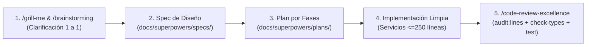

# Guía General de Desarrollo y Arquitectura de Backend (SIS-SIRCA)

Esta guía integra las mejores prácticas de ingeniería de software del proyecto SIS-SIRCA combinando nuestros **10 pilares de calidad** y el **[Glosario de Dominio (`GLOSSARY.md`)](../../GLOSSARY.md)**:
1. `/brainstorming` y `/grill-me` (Diseño colaborativo previo al código)
2. [`GLOSSARY.md`](../../GLOSSARY.md) y [`/sirca-module-blueprint`](../../.agents/skills/sirca-module-blueprint/SKILL.md) (Lenguaje ubicuo y runbook paso a paso de creación/refactorización de módulos)
3. `/architecture-patterns` (Clean Architecture, DDD y Fachadas modulares)
4. `/nestjs-best-practices` (SRP, Inyección de Dependencias sin `@Inject(REQUEST)`, Eventos y Transacciones)
5. `/api-design-principles` (Controladores por sub-recurso, Pipes, DTOs como `class` con `@Transform` y Paginación estándar)
6. `/typescript-advanced-types` (Tipado estricto, Generics, Uniones Discriminadas y cero `...dto`)
7. `/postgresql-table-design` (`TIMESTAMPTZ`, `NUMERIC` con `decimalTransformer`, Índices FK, `CHECK` constraints y relaciones en objeto)
8. `/error-handling-patterns` (`DomainException`, `ErrorCode`, filtros globales y **Cero-PHI en logs**)
9. [`/tdd`](../../.agents/skills/tdd/SKILL.md) (Pruebas por *seams* públicos, rebanadas verticales y cero tests tautológicos)
10. `/code-review-excellence` (Auditoría sistemática de calidad y límites de líneas)

---

## 1. Ciclo de Vida de Todo Cambio (Spec-Driven Workflow)

Ninguna funcionalidad ni refactorización se programa a ciegas. Todo desarrollo sigue este flujo:



---

## 2. Estándar Arquitectónico de un Módulo (`src/<feature>/`)

Cuando un módulo crece (como ocurrió en `billing/payments` o `eventualities`), se estructura separando **Controladores por Sub-recurso**, **Sub-servicios de Dominio**, una **Fachada de Compatibilidad** y **Helpers Puros**:

```text
src/eventualities/
├── controllers/
│   ├── eventualities.controller.ts                 # Admisión, listado general y ciclo de vida (<180 líneas)
│   ├── eventuality-doctor.controller.ts            # Triaje, cola médica y consulta APS (<120 líneas)
│   ├── eventuality-document.controller.ts          # Informes médicos, OCR y descargas PDF (<150 líneas)
│   └── eventuality-billing.controller.ts           # Hoja de consumo, baremos y facturas (<150 líneas)
├── services/
│   ├── eventualities.service.ts                    # Fachada (Facade) retrocompatible (<120 líneas)
│   ├── eventuality-emergency.service.ts            # Creación, aprobación, rechazo y cierre de emergencias
│   ├── eventuality-medical-report.service.ts       # Subida a S3, extracción OCR y edición de informe médico
│   ├── eventuality-consumption.service.ts          # Conciliación de consumos, recálculo por tasa y alertas
│   ├── eventuality-provider-invoice.service.ts     # Extracción y registro de facturas de proveedores
│   ├── eventuality-doctor-consultation.service.ts  # Dashboard médico, cola APS, reclamo y guardado clínico
│   ├── eventuality-service-request.service.ts      # Órdenes de servicio y cancelaciones
│   ├── eventuality-general.service.ts              # Creación de APS, por órdenes y eventualidad general
│   ├── eventuality-query.service.ts                # Búsqueda paginada (findAll) y detalle (findOne)
│   ├── eventuality-ocr.service.ts                  # Integración con motor OCR
│   ├── eventuality-pdf.service.ts                  # Generación de reportes PDF
│   └── eventuality-statistics.service.ts           # Estadísticas diarias
├── helpers/
│   ├── claim-number-generator.helper.ts            # Generador atómico de correlativos de siniestro
│   └── consumption-calculator.helper.ts            # Cálculos puros de cobertura, tasas y baremos
├── dto/
├── entities/
└── eventualities.module.ts
```

---

## 3. Patrones de Implementación con la Infraestructura de `src/common`

### 3.1. Transacciones con `@Transactional()` y `registerPostCommitHook()`
En lugar de acoplar los servicios a `this.dataSource.transaction(async (manager) => ...)` y ejecutar llamadas HTTP a WhatsApp o S3 dentro de la transacción de base de datos, usamos las utilidades de `src/common`:

```typescript
import { Injectable, Logger } from '@nestjs/common';
import { InjectRepository } from '@nestjs/typeorm';
import { Repository } from 'typeorm';
import { Transactional } from '../../common/decorators/transactional.decorator';
import { registerPostCommitHook } from '../../common/context/request-context';
import {
  EntityNotFoundException,
  InvalidDomainOperationException,
  ErrorCode,
} from '../../common/exceptions';
import { Eventuality, EventualityStatus } from '../entities/eventuality.entity';

@Injectable()
export class EventualityEmergencyService {
  private readonly logger = new Logger(EventualityEmergencyService.name);

  constructor(
    @InjectRepository(Eventuality)
    private readonly eventualityRepo: Repository<Eventuality>,
    private readonly coveragePeriodService: CoveragePeriodService,
    private readonly metaWhatsappService: MetaWhatsappService,
  ) {}

  @Transactional()
  async approveEmergency(id: string, userId?: string): Promise<Eventuality> {
    const eventuality = await this.eventualityRepo.findOne({
      where: { id },
      relations: ['person', 'coveragePeriod'],
    });

    if (!eventuality) {
      throw new EntityNotFoundException('Eventualidad', id);
    }

    if (eventuality.status !== EventualityStatus.PENDING_APPROVAL) {
      throw new InvalidDomainOperationException(
        `Solo se pueden aprobar emergencias en estado PENDING_APPROVAL (actual: ${eventuality.status})`,
        ErrorCode.INVALID_DOMAIN_OPERATION,
      );
    }

    eventuality.status = EventualityStatus.CLINIC_PROCESS;
    eventuality.approvedById = userId ?? null;
    const saved = await this.eventualityRepo.save(eventuality);

    // Efecto secundario (WhatsApp) se ejecuta SOLO después de confirmar el COMMIT en BD
    registerPostCommitHook(async () => {
      await this.notifyApprovalViaWhatsapp(saved);
    });

    return saved;
  }
}
```

### 3.2. Diseño de APIs y Segregación de Controladores (`/api-design-principles`)
Para evitar controladores de más de 250 líneas sin cambiar las URLs que consume el Frontend, dividimos por sub-recurso manteniendo `@Controller('eventualities')`:

```typescript
// controllers/eventuality-doctor.controller.ts
@Controller('eventualities')
export class EventualityDoctorController {
  constructor(
    private readonly doctorConsultationService: EventualityDoctorConsultationService,
  ) {}

  @Get('doctor/dashboard')
  @RequirePermissions('attend:aps', 'read:eventualities')
  async getDashboardStats(@CurrentUser() user: JwtPayload) {
    return this.doctorConsultationService.getDoctorDashboardStats(user.userId);
  }

  @Get('doctor/queue')
  @RequirePermissions('attend:aps', 'read:eventualities')
  async getQueue(
    @CurrentUser() user: JwtPayload,
    @Query() query: FindDoctorQueueDto, // Extiende PaginationQueryDto (page, limit validados)
  ) {
    return this.doctorConsultationService.getDoctorQueue(user.userId, query);
  }

  @Post(':id/claim-patient')
  @RequirePermissions('attend:aps', 'update:eventualities')
  async claimPatient(
    @Param('id', ParseUUIDPipe) id: string, // Siempre ParseUUIDPipe
    @CurrentUser() user: JwtPayload,
  ) {
    return this.doctorConsultationService.claimPatient(id, user.userId);
  }
}
```

### 3.3. Tipado Avanzado, DTOs y Mapeo Explícito (`/typescript-advanced-types`)
1. **Prohibido `any`**: Si un dato externo (ej. respuesta cruda de IA/OCR o webhook) no tiene tipo conocido, se declara `unknown` y se valida con un *Type Guard*.
2. **DTOs siempre como `class` con `@Transform`**: Nunca usar `interface` para DTOs de `@Body()` o `@Query()`. Sanitizar cadenas con `@Transform` (`trim()`, `toUpperCase()`) y declarar propiedades como `readonly`.
3. **Prohibido `...dto` (`no-misused-spread`)**: Asignar explícitamente cada campo al construir o actualizar entidades TypeORM en lugar de hacer spread de instancias de clases.
4. **Uniones Discriminadas para Estados de Proceso**:
   ```typescript
   export type OcrProcessingOutcome<TData> =
     | { readonly status: 'COMPLETED'; readonly data: TData; readonly confidence: number }
     | { readonly status: 'FAILED'; readonly errorCode: ErrorCode; readonly reason: string };
   ```
5. **Utility Types**: Reutilizar contratos con `Readonly<T>`, `Pick<T, K>` y `Omit<T, K>` en lugar de duplicar interfaces.

### 3.4. Estándares de Esquema PostgreSQL y Privacidad Cero-PHI (`/postgresql-table-design`)
Cada entidad TypeORM, servicio y migración debe cumplir:
1. **Nombres en `snake_case`**: Tanto tablas como columnas (`name: 'coverage_period_id'`), alineados con [`GLOSSARY.md`](../../GLOSSARY.md).
2. **Relaciones en sintaxis de objeto**: Preferir `relations: { person: true, coveragePeriod: true }` sobre arrays de strings `relations: ['person']`.
3. **Dinero exacto**: `NUMERIC(12, 2)` + `transformer: decimalTransformer`. Nunca `float`.
4. **Fechas con zona horaria**: `type: 'timestamptz'` para eventos; `type: 'date'` solo para fechas puras.
5. **Índices explícitos en FKs**: PostgreSQL no crea índices automáticos en claves foráneas. Toda relación `@ManyToOne` debe incluir `@Index('IDX_<tabla>_<fk_col>')`.
6. **Restricciones de dominio en BD**: Usar `@Check(...)` para garantizar que montos como `total_cost >= 0` y que columnas de estado solo acepten valores válidos.
7. **Privacidad Clínica Cero-PHI en Logs**: Prohibido usar `console.log` o registrar diagnósticos CIE-10, textos de informes médicos o declaraciones de salud en logs. Registrar únicamente UUIDs internos (`eventualityId`, `contractId`, `personId`, `requestId`).

---

## 4. Protocolo de Revisión de Código (`/code-review-excellence`)

Antes de cerrar cualquier tarea o abrir un Pull Request, verificar con severidad clasificada:

| Severidad | Categoría | Verificación |
| :--- | :--- | :--- |
| 🔴 **[blocking]** | Tamaño y SRP | `npm run audit:lines`: Ningún archivo tocado o nuevo supera 300 líneas; ningún constructor supera 5 dependencias ni usa `@Inject(REQUEST)`. |
| 🔴 **[blocking]** | Transaccionalidad | Operaciones de escritura multi-tabla usan `@Transactional()` y los efectos externos usan `registerPostCommitHook()`. |
| 🔴 **[blocking]** | Tipado y Seguridad | `npm run check-types` pasa con 0 errores; cero `any`; cero `...dto`; todos los UUID usan `ParseUUIDPipe`; Cero-PHI en logs. |
| 🟡 **[important]** | Base de Datos | Sin queries N+1 en bucles (`for ... await repo.findOne`); FKs indexadas; montos con `decimalTransformer`. |
| 🟡 **[important]** | Pruebas Unitarias ([`/tdd`](../../.agents/skills/tdd/SKILL.md)) | Helpers puros y sub-servicios cuentan con sus pruebas unitarias por *seams* en `*.spec.ts` y `npm run test` pasa en verde. |
