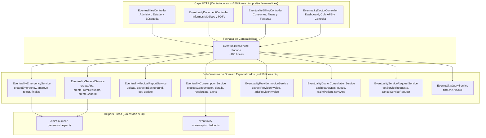

# Especificación de Diseño: Gobernanza Arquitectónica y Refactorización de `EventualitiesModule`

**Fecha**: 2026-10-27  
**Módulo Principal**: `src/eventualities` y Gobernanza Global (`AGENTS.md`)  
**Estado**: Aprobado en Brainstorming / Listo para Revisión  

---

## 1. Contexto y Problema

1. **Deuda Técnica Crítica en `EventualitiesService`**:
   - `src/eventualities/services/eventualities.service.ts` acumula **2.192 líneas de código**, **18 dependencias en su constructor** y **27 métodos públicos** que mezclan 6 sub-dominios: ciclo de vida de emergencias, informes médicos con OCR, conciliación de hojas de consumo, facturas de proveedores, cola médica de consultas APS y órdenes de servicio.
   - `src/eventualities/controllers/eventualities.controller.ts` acumula **372 líneas**, omite `ParseUUIDPipe` en varios endpoints de descarga PDF y parsea parámetros de paginación manualmente (`parseInt(page, 10)`) en lugar de utilizar `PaginationQueryDto`.
   - Ignora las abstracciones estándar del proyecto en `src/common`: usa `this.dataSource.transaction()` manual en lugar de `@Transactional()`, lanza excepciones HTTP genéricas (`BadRequestException`) en lugar de `DomainException` con `ErrorCode`, y dispara efectos secundarios (WhatsApp/OCR) de forma acoplada.
2. **Necesidad de Gobernanza Global**:
   - Establecer una estructura obligatoria apoyada en los 9 skills del proyecto (`/brainstorming`, `/grill-me`, `/architecture-patterns`, `/nestjs-best-practices`, `/api-design-principles`, `/typescript-advanced-types`, `/postgresql-table-design`, `/error-handling-patterns`, `/code-review-excellence`) para que cada nuevo cambio o refactorización siga un proceso predecible y auditable.

---

## 2. Decisiones Arquitectónicas Acordadas

1. **Flujo Spec-Driven Obligatorio**:
   - Todo nuevo feature o refactorización sigue la secuencia: 1) `/grill-me` + `/brainstorming` -> 2) Spec en `docs/superpowers/specs/` -> 3) Plan en `docs/superpowers/plans/` -> 4) Implementación -> 5) `/code-review-excellence` (solo hotfixes `<30 líneas` van directo).
2. **Estándar de Capa de Servicios y Transacciones**:
   - Descomposición en sub-servicios de dominio de **máximo 200-250 líneas** (límite duro: 300 líneas) y **máximo 4-5 dependencias en el constructor**.
   - Uso de `@Transactional()` (`src/common/decorators/transactional.decorator.ts`) y `registerPostCommitHook()` (`src/common/context/request-context.ts`) para desacoplar notificaciones WhatsApp y tareas OCR en segundo plano de la transacción de base de datos.
   - Uso de `DomainException` (`EntityNotFoundException`, `InvalidDomainOperationException`, `ExternalServiceException`) con códigos tipados en `ErrorCode`.
   - Mantenimiento de `EventualitiesService` como **Fachada (Facade)** ligera (`<120 líneas`) para preservar el 100% de retrocompatibilidad con tests y consumidores externos.
3. **Estándar de Capa de Controladores y API REST**:
   - Segregación de `EventualitiesController` en 4 controladores por sub-recurso manteniendo el prefijo `@Controller('eventualities')` y las rutas exactas para no romper el Frontend.
   - Uso obligatorio de `ParseUUIDPipe` en todos los `@Param('id')` y DTOs basados en `PaginationQueryDto`.
4. **Tipado y Base de Datos**:
   - Cero `any` (reemplazar por tipos explícitos, genéricos o uniones discriminadas con `readonly`).
   - Cumplimiento estricto de PostgreSQL: `TIMESTAMPTZ`, `NUMERIC(12,2)` con `decimalTransformer`, índices explícitos en todas las FKs y `CHECK` constraints.

---

## 3. Arquitectura Objetivo para `EventualitiesModule`

---

## 4. Descomposición Detallada de Componentes

### 4.1. Helpers Puros (`src/eventualities/helpers/`)
1. **`claim-number-generator.helper.ts`** (Existente - 45 líneas): Generación atómica del correlativo de siniestro.
2. **`eventuality-consumption.helper.ts`** (Nuevo - ~90 líneas):
   - Funciones puras para cálculo de montos en USD/Bs según tasa cambiaria, prorrateo de cobertura vs. exceso del paciente, y evaluación de umbrales de alerta de consumo.

### 4.2. Sub-Servicios de Dominio (`src/eventualities/services/`)
1. **`EventualityQueryService`** (~90 líneas):
   - Métodos: `findOne(id)`, `findAll(query)`.
   - Dependencias: `eventualityRepo`.
2. **`EventualityServiceRequestService`** (~100 líneas):
   - Métodos: `getServiceRequests(dto)`, `cancelServiceRequest(requestId, reason)`.
   - Dependencias: `serviceRequestRepo`.
3. **`EventualityMedicalReportService`** (~210 líneas):
   - Métodos: `uploadMedicalReport`, `extractMedicalReportInBackground`, `getMedicalReport`, `updateMedicalReportData`.
   - Dependencias: `eventualityRepo`, `medicalReportRepo`, `awsService`, `eventualityOcrService`.
4. **`EventualityProviderInvoiceService`** (~110 líneas):
   - Métodos: `extractProviderInvoice`, `addProviderInvoice`.
   - Dependencias: `eventualityRepo`, `invoiceRepo`, `awsService`, `eventualityOcrService`.
5. **`EventualityConsumptionService`** (~260 líneas):
   - Métodos: `processConsumptionFile`, `getExtractionDetails`, `updateExtractionDetails`, `recalculateConsumptionByDate`, `getConsumptionAlertConfig`, `updateConsumptionAlertConfig`.
   - Dependencias: `eventualityRepo`, `extractionDetailRepo`, `systemSettingsService`, `exchangeRateService`, `eventualityOcrService` (+ `awsService` o delegación de carga).
6. **`EventualityDoctorConsultationService`** (~230 líneas):
   - Métodos: `getDoctorDashboardStats`, `getDoctorQueue`, `claimPatient`, `saveApsConsultation`.
   - Dependencias: `eventualityRepo`, `doctorRepo`, `medicalReportRepo`, `treatmentItemRepo`, `serviceRequestRepo`.
7. **`EventualityGeneralService`** (~220 líneas):
   - Métodos: `createAps`, `createFromRequests`, `createGeneralEventuality`.
   - Dependencias: `eventualityRepo`, `personRepo`, `contractPersonRepo`, `serviceRequestRepo`, `medicalServiceRepo`.
8. **`EventualityEmergencyService`** (~260 líneas):
   - Métodos: `createEmergency`, `approveEmergency`, `rejectEmergency`, `finalizeEmergency`.
   - Dependencias: `eventualityRepo`, `movementRepo`, `coveragePeriodService`, `systemSettingsService`, `metaWhatsappService`.
9. **`EventualitiesService` (Fachada)** (~110 líneas):
   - Delega los 27 métodos públicos hacia los 8 sub-servicios anteriores manteniendo intactas las firmas públicas.

### 4.3. Controladores Segregados (`src/eventualities/controllers/`)
Todos bajo `@Controller('eventualities')`:
1. **`EventualitiesController`** (~140 líneas): Creación (`emergency`, `aps`, `from-requests`, `general`), aprobación/rechazo/finalización (`:id/approve`, `:id/reject`, `:id/finalize`), listado y detalle (`GET /`, `GET /:id`), estadísticas (`stats/daily`).
2. **`EventualityDoctorController`** (~90 líneas): `doctor/dashboard`, `doctor/queue`, `:id/claim-patient`, `:id/aps-consultation`, `service-requests`, `service-requests/:requestId/cancel`.
3. **`EventualityDocumentController`** (~120 líneas): `:id/medical-report` (`POST`, `GET`, `PUT`) y descargas PDF (`:id/pdf`, `:id/medical-report/pdf`, `:id/prescription/pdf`, `:id/service-orders/pdf`, `:id/consumption-sheet/pdf`) añadiendo `ParseUUIDPipe` en todos los `:id`.
4. **`EventualityBillingController`** (~110 líneas): `settings/consumption-alert`, `:id/consumption`, `:id/extraction-details`, `:id/extraction-details/recalculate-rate`, `:id/provider-invoices/extract`, `:id/provider-invoices`.

---

## 5. Estrategia de Manejo de Errores y Pruebas

- **Códigos de Error (`ErrorCode`)**: Ampliar `src/common/exceptions/error-codes.enum.ts` con códigos específicos de eventualidades (`EVENTUALITY_INVALID_STATUS`, `COVERAGE_EXHAUSTED`, `MEDICAL_REPORT_NOT_FOUND`) manteniendo compatibilidad HTTP (400/404) a través de `GlobalExceptionFilter`.
- **Pruebas Unitarias**:
  - Cada nuevo sub-servicio y helper puro tendrá su suite `*.spec.ts` dedicada.
  - `eventualities.service.spec.ts` y `eventualities.controller.spec.ts` seguirán pasando al 100% gracias al patrón Fachada.
