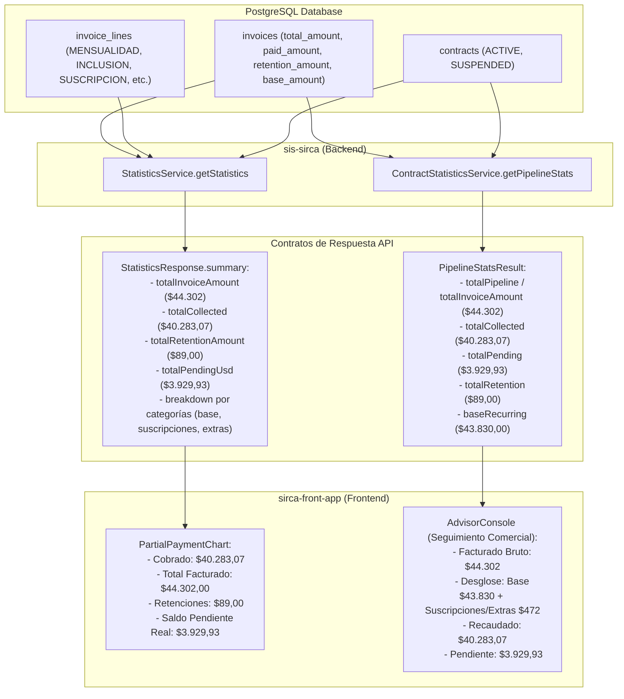

# Especificación de Diseño: Alineación de Retenciones, Facturación y Pipeline (Dashboard vs Seguimiento Comercial)

**Fecha**: 2026-10-29  
**Módulos Afectados**: `billing`, `contracts`, `statistics`, Frontend (`sirca-front-app`)  
**Ramas de Trabajo**: `fix-dashboard-retention-alignment` (en `sis-sirca` y `sirca-front-app`)  
**Estado**: Aprobado por el usuario tras entrevista `/grill-me`

---

## 1. Contexto y Objetivos

Actualmente existen discrepancias entre el módulo de **Seguimiento Comercial** (`/contracts/pipeline-stats`) y el **Dashboard General** (`/statistics` / `PartialPaymentChart`):

1. **Total Facturado vs. Cartera Activa**:
   * Seguimiento Comercial reporta $43.830,00 (solo `baseAmount` de mensualidades regulares).
   * El Dashboard reporta $44.302,00 (el total bruto emitido, que incluye cuotas de suscripción de $5 y cargos adicionales/inclusiones de afiliados).
2. **Saldo Pendiente Inflado por Retenciones**:
   * En el Dashboard, el gráfico `PartialPaymentChart` calcula el saldo pendiente como `totalInvoiceAmount - totalCollected` sin descontar las retenciones fiscales ya liquidadas en facturas pagadas (`PAID`). Esto muestra como deuda pendiente dinero que legalmente fue retenido y no se debe cobrar.
3. **Omisión de Facturas Secundarias en Seguimiento Comercial**:
   * `ContractStatisticsService.classifyContractByMonth` utiliza `contract.invoices?.find(...)`, tomando solo la primera factura encontrada en el mes. Si un contrato tuvo una factura de afiliación/inclusión y luego una factura mensual en el mismo mes, la segunda factura y sus cobros son ignorados, generando una discrepancia de cobros ($40.245,07 vs $40.283,07).
4. **Desconexión entre Conteo de Afiliados y Cuotas de Suscripción**:
   * Las líneas de factura de categoría `SUSCRIPCION` ($5 de comisión de apertura) suman dinero a la factura, pero tienen `person: null`, lo que generaba confusión al comparar el dinero total vs el conteo de afiliados.

### Objetivos:
- **Consistencia 100% de Cobrado**: Ambas pantallas reportarán el mismo valor exacto de dinero cobrado ($40.283,07).
- **Tratamiento Contable Correcto de Retenciones**: El Total Facturado se mantiene como valor bruto (sin restar retención). El Saldo Pendiente se calcula descontando las retenciones fiscales (`Total Facturado - Retenciones - Cobrado = Saldo Pendiente Real`).
- **Visibilidad y Desglose Transparente**: Desglosar en la interfaz los componentes del total facturado (Cartera recurrente + Cuotas de apertura de contratos + Inclusiones/Extras) y mostrar el monto retenido en el pie del gráfico.

---

## 2. Diagrama de Flujo y Arquitectura



---

## 3. Especificación Técnica de Componentes

### 3.1. Backend (`sis-sirca`)

#### A. `src/statistics/services/statistics.service.ts`
1. **Consulta `queryInvoiceSummary`**:
   - Agregar a la consulta SQL:
     ```sql
     COALESCE(SUM(i.retention_amount), 0) AS total_retention,
     COALESCE(SUM(i.base_amount), 0)      AS total_base_amount
     ```
   - En `InvoiceSummaryRaw`, tipar `total_retention: string` y `total_base_amount: string`.
2. **Consulta `querySubscriptionLines` (o integración en `buildSummary`)**:
   - Obtener el total y cantidad de cuotas de apertura (`category = 'SUSCRIPCION'`).
3. **Mapeo en `buildSummary`**:
   - `totalRetentionAmount`: `Number(inv.total_retention)`.
   - `totalBaseAmount`: `Number(inv.total_base_amount)`.
   - `totalPendingUsd`: `Math.max(0, Number(inv.grand_total_amount) - Number(inv.total_retention) - Number(inv.total_collected))`.
4. **Actualización de interfaces (`src/statistics/interfaces/response.interface.ts`)**:
   - Extender `StatisticsSummary` con `totalRetentionAmount: number`, `totalBaseAmount: number`, `subscriptionFeesCount?: number`, `subscriptionFeesAmount?: number`.

#### B. `src/contracts/services/contract-statistics.service.ts`
1. **Iterar sobre todas las facturas del periodo**:
   - En `classifyContractByMonth`:
     Reemplazar:
     ```typescript
     const targetInvoice = contract.invoices?.find((inv) => inv.billingMonth === targetBillingMonth);
     ```
     Por:
     ```typescript
     const targetInvoices = contract.invoices?.filter((inv) => inv.billingMonth === targetBillingMonth) ?? [];
     if (targetInvoices.length === 0) return;
     for (const targetInvoice of targetInvoices) {
       // acumular montos, totales y conteos
     }
     ```
2. **Alineación de `totalPipeline` y Retenciones**:
   - Total facturado acumula `targetInvoice.totalAmount` (o expone `baseRecurring` y `totalInvoiceAmount` por separado).
   - `amountDue = Math.max(0, Number(targetInvoice.totalAmount) - Number(targetInvoice.retentionAmount || 0))`.

---

### 3.2. Frontend (`sirca-front-app`)

#### A. Tipos (`lib/types.ts`)
- Actualizar `StatisticsSummary` con `totalRetentionAmount: number`, `totalBaseAmount: number`, etc.

#### B. `components/dashboard/PartialPaymentChart.tsx`
- Recibir `totalRetentionAmount?: number`.
- Cálculo del saldo pendiente real:
  ```typescript
  const remaining = Math.max(
    0,
    totalInvoiceAmount - (totalRetentionAmount ?? 0) - totalCollected,
  );
  ```
- En el pie del gráfico, mostrar:
  ```tsx
  <div className="flex flex-wrap items-center justify-between text-xs mt-4 pt-3 border-t border-[#e2ebe2]">
    <div>Cobrado: <span className="font-bold text-[#16a34a]">{formatUsd(totalCollected)}</span></div>
    <div>Total facturado: <span className="font-bold text-[#f97316]">{formatUsd(totalInvoiceAmount)}</span></div>
    {totalRetentionAmount > 0 && (
      <div>Retenciones: <span className="font-bold text-[#64748b]">{formatUsd(totalRetentionAmount)}</span></div>
    )}
    <div>Saldo pendiente: <span className="font-bold text-[#dc2626]">{formatUsd(remaining)}</span></div>
  </div>
  ```

#### C. `components/dashboard/contracts/AdvisorConsole.tsx`
- Mostrar en la tarjeta de Cartera / Facturación el total facturado ($44.302,00) junto a un tooltip o detalle:
  - *Mensualidades base:* $43.830,00
  - *Cuotas de suscripción / apertura:* $45,00
  - *Inclusiones / Cargos adicionales:* $427,00

---

## 4. Estrategia de Pruebas

1. **Pruebas Unitarias Backend (`sis-sirca`)**:
   - `statistics.service.spec.ts`: Verificar que `totalRetentionAmount` se extraiga y mapee correctamente, y que `totalPendingUsd` descuente las retenciones.
   - `contract-statistics.service.spec.ts`: Testear contrato con múltiples facturas en el mismo mes (ej. afiliación con cuota de suscripción + factura mensual) verificando que `totalCollected` sume ambas.
2. **Auditoría de Calidad**:
   - `npm run check-types`
   - `npm run test`
   - `npm run audit:lines` (mantener servicios <300 líneas y controladores <250 líneas).
