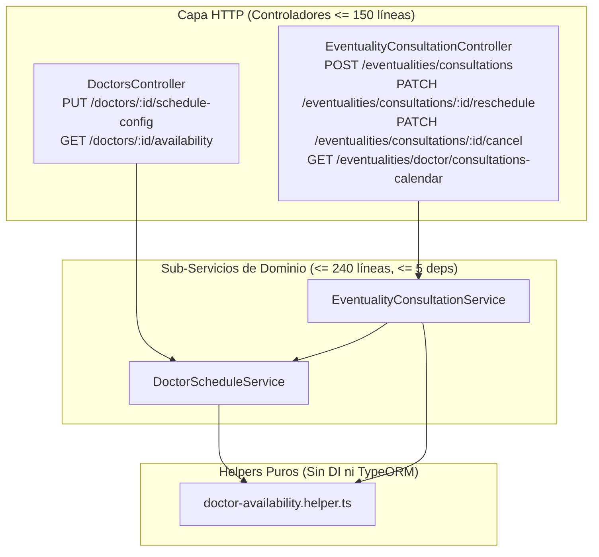

# Especificación de Diseño: Eventualidad de Tipo Consulta (`CONSULTATION`) y Agenda Médica

**Fecha**: 2026-11-08  
**Módulos Afectados**: `src/doctors`, `src/eventualities` (`sis-sirca`) y `sirca-front-app`  
**Estado**: Aprobado  

---

## 1. Objetivos y Alcance

1. **Configuración de Agenda por Médico (`src/doctors`)**:
   - Permitir configurar en cada [`Doctor`](file:///c:/Users/User/Proyectos/sirca/sis-sirca/src/doctors/entities/doctor.entity.ts) los días de consulta habilitados con su rango horario (`startTime` - `endTime`), duración de cada consulta en minutos (`consultationDurationMinutes`), topes de consultas (**diario, semanal y mensual**) y servicio médico predeterminado del baremo (`defaultMedicalServiceId`).
2. **Cálculo de Disponibilidad y Agendamiento (`CONSULTATION`)**:
   - Exponer el cálculo de disponibilidad real por médico para un rango de fechas (`GET /doctors/:id/availability`), generando bloques horarios exactos y evaluando citas existentes y topes diario/semanal/mensual.
   - Soportar el agendamiento (`POST /eventualities/consultations`), reprogramación (`PATCH /eventualities/consultations/:id/reschedule`) y cancelación (`PATCH /eventualities/consultations/:id/cancel`) de citas en estado `SCHEDULED`.
   - Habilitar la pestaña **"Asignación de Consultas"** en el Panel de Registros (`/dashboard/pagos-asesores?tab=consultation`) y el selector de calendario de disponibilidad en Operaciones (`/dashboard/verificacion`).
3. **Calendario del Médico y Paso a Espera de Factura (`/dashboard/medico`)**:
   - Exponer la agenda médica (`GET /eventualities/doctor/consultations-calendar`) mostrando las consultas del día de hoy con su hora y las de los días siguientes.
   - Permitir al médico **redactar el informe médico** o **subir un archivo de informe médico (PDF/imagen)** desde una consulta en estado `SCHEDULED`, pasando automáticamente la eventualidad a estado `WAITING_INVOICE` (*Esperando Factura*).

---

## 2. Arquitectura y Descomposición de Componentes

---

## 3. Modelo de Datos y Reglas de Integridad PostgreSQL

- **Tabla `doctors`** (Migración `1793300000000-AddDoctorScheduleConfigColumns.ts`):
  - `consultation_duration_minutes INTEGER NOT NULL DEFAULT 30` (`CHECK ("consultation_duration_minutes" >= 5 AND "consultation_duration_minutes" <= 240)`)
  - `max_daily_consultations INTEGER NULL` (`CHECK ("max_daily_consultations" IS NULL OR "max_daily_consultations" >= 1)`)
  - `max_weekly_consultations INTEGER NULL` (`CHECK ("max_weekly_consultations" IS NULL OR "max_weekly_consultations" >= 1)`)
  - `max_monthly_consultations INTEGER NULL` (`CHECK ("max_monthly_consultations" IS NULL OR "max_monthly_consultations" >= 1)`)
  - `weekly_schedule JSONB NOT NULL DEFAULT '[]'::jsonb`
  - `default_medical_service_id UUID NULL` con FK `FK_doctors_default_medical_service` e índice `IDX_doctors_default_medical_service_id`.
- **Tabla `eventualities`**:
  - Índice compuesto `IDX_eventualities_doctor_type_admission` sobre `(doctor_id, type, admission_date)`.

---

## 4. Manejo de Errores y Estrategia de Pruebas

- **Excepciones de Dominio**: Uso de `EntityNotFoundException` e `InvalidDomainOperationException` (`src/common/exceptions/domain-exceptions.ts`) para validaciones de cupos agotados, bloques ocupados, contratos inactivos o estados inválidos.
- **TDD y Pruebas Unitarias**:
  - `doctor-availability.helper.spec.ts`: Pruebas puras de generación de slots, cruces de citas agendadas y límites diario/semanal/mensual.
  - `doctor-schedule.service.spec.ts`: Pruebas unitarias de actualización de agenda y consulta de disponibilidad.
  - `eventuality-consultation.service.spec.ts`: Pruebas unitarias de agendamiento, reserva de cobertura, reprogramación, cancelación y consulta de calendario médico.
