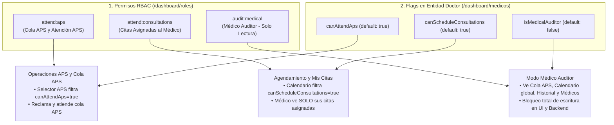

# Especificación de Diseño: Permisos de Médico (APS, Citas Asignadas y Médico Auditor)

- **Fecha**: 2026-11-09
- **Proyectos Afectados**: `sis-sirca` (Backend NestJS + TypeORM) y `sirca-front-app` (Frontend Next.js)
- **Estado**: Pendiente de Aprobación

---

## 1. Objetivos y Reglas de Negocio

Implementar un modelo de permisos granulares para médicos tanto a nivel de **Roles y Permisos RBAC (`permissions` / `roles`)** como en la **Ficha del Médico (`Doctor`)**:

1. **Permiso para ser asignado a APS (`attend:aps` + `doctor.canAttendAps`)**:
   - Permite al médico ver la cola de Atención Primaria (`Pacientes por Atender APS`), reclamar pacientes en sala de espera (`claimPatient`) y aparecer en los selectores de asignación de médico para atenciones APS.
2. **Permiso para agendar citas (`attend:consultations` + `doctor.canScheduleConsultations`)**:
   - Permite que al médico se le agenden citas en el calendario de disponibilidad (`DoctorAvailabilityCalendarPicker`).
   - En el Panel Médico (`/dashboard/medico`), el médico con este permiso puede ver y atender **únicamente las citas asignadas a él** (`eventuality.doctorId === user.doctorId`).
3. **Médico Auditor (`audit:medical` + `doctor.isMedicalAuditor`)**:
   - Puede visualizar **todo lo relacionado con médicos**: Panel Médico completo (cola APS, calendario de consultas de todos los médicos, historial de pacientes atendidos), fichas de atención médica (`/dashboard/medico/atencion/[id]`), descargas de PDFs (informes, récipes, órdenes) y el Directorio de Médicos (`/dashboard/medicos`).
   - **Restricción absoluta de solo lectura**: No puede reclamar pacientes, ni redactar/guardar/finalizar informes médicos, ni subir archivos de informes, ni reprogramar/cancelar citas, ni crear/editar médicos o configurar agendas.

---

## 2. Arquitectura y Flujo de Permisos

---

## 3. Cambios en Base de Datos y Backend (`sis-sirca`)

### 3.1. Migración `1793400000000-AddDoctorPermissionsAndAuditorRole.ts`
- **Columnas en tabla `doctors`**:
  - `can_attend_aps BOOLEAN NOT NULL DEFAULT true`
  - `can_schedule_consultations BOOLEAN NOT NULL DEFAULT true`
  - `is_medical_auditor BOOLEAN NOT NULL DEFAULT false`
- **Semilla de Permisos en `permissions`**:
  - `attend:aps`: `"Ver cola de APS y ser asignado para atender pacientes en APS"`
  - `attend:consultations`: `"Agendar citas y ver/atender únicamente las consultas asignadas al médico"`
  - `audit:medical`: `"Médico Auditor: ver todo lo relacionado con médicos sin permisos de escritura ni edición"`
  - `manage:doctors`: `"Crear y administrar perfiles y agendas de médicos"`
- **Semilla de Roles en `roles` y `role_permissions`**:
  - `Medico`: `attend:aps`, `attend:consultations`
  - `Medico Consultas`: `attend:consultations`
  - `Medico Auditor`: `audit:medical`
  - `admin`: todos los permisos anteriores.

### 3.2. Entidad, DTOs y Servicios en `src/doctors/`
- `Doctor` (`src/doctors/entities/doctor.entity.ts`): propiedades `canAttendAps`, `canScheduleConsultations`, `isMedicalAuditor`.
- `CreateDoctorDto` / `UpdateDoctorDto`: propiedades booleanas opcionales `canAttendAps`, `canScheduleConsultations`, `isMedicalAuditor`.
- `DoctorsService.findAll`: filtros opcionales `canAttendAps?: boolean` y `canScheduleConsultations?: boolean`.
- `DoctorsController`:
  - `GET /doctors`: accesible para usuarios autenticados (incluyendo `audit:medical`).
  - `POST /doctors`, `PATCH /doctors/:id`, `PUT /doctors/:id/schedule-config`, `POST /doctors/:id/signature`: protegidos con `@RequirePermissions('manage:doctors', 'create:users', 'update:users')` (bloqueando al Médico Auditor).

### 3.3. Reglas de Autorización en `src/eventualities/`
- **`EventualityConsultationService`**:
  - `scheduleConsultation` y `rescheduleConsultation`: verifican que `doctor.canScheduleConsultations !== false` y `!doctor.isMedicalAuditor`.
  - `getDoctorConsultationsCalendar(user, query)`:
    - Si el usuario solo posee `attend:consultations` (sin `audit:medical`, `read:eventualities` ni `manage:doctors`), fuerza `resolvedDoctorId = user.doctorId` para que únicamente vea las citas asignadas a él.
    - Si posee `audit:medical`, permite ver el calendario de cualquier médico o de todos los médicos.
- **Guardia contra Escritura del Médico Auditor**:
  - En `claimPatient`, `saveApsConsultation`, `uploadMedicalReport`, `rescheduleConsultation` y `cancelConsultation`: si el médico vinculado tiene `isMedicalAuditor === true` o el rol solo tiene `audit:medical` sin permisos de atención activa, lanza `UnauthorizedDomainException('El perfil de Médico Auditor es de solo lectura y no permite crear ni editar registros clínicos.')`.

---

## 4. Cambios en Frontend (`sirca-front-app`)

1. **`Sidebar.tsx`**:
   - Sub-sección **Médico -> Panel Médico (`/dashboard/medico`)**: visible con `anyPermissions: ['attend:aps', 'attend:consultations', 'audit:medical']`.
   - Sub-sección **Configuración -> Médicos (`/dashboard/medicos`)**: visible con `anyPermissions: ['read:users', 'manage:doctors', 'audit:medical']`.
2. **`DoctorsManager.tsx` (`/dashboard/medicos`)**:
   - Agrega los 3 switches en el modal de Crear/Editar Médico:
     - **Asignable a APS (`canAttendAps`)**
     - **Asignable a Citas Programadas (`canScheduleConsultations`)**
     - **Médico Auditor - Solo Lectura (`isMedicalAuditor`)**
   - Muestra badges de permisos en cada fila de la tabla.
   - Si el usuario en sesión es **Médico Auditor** (sin `manage:doctors` ni `read:users`), oculta los botones *"Registrar Nuevo Médico"*, *"Agenda"* y *"Editar"*.
3. **Selectores de Médicos (`OperativeActionModal.tsx` y `DoctorAvailabilityCalendarPicker.tsx`)**:
   - Cuando se selecciona APS en `OperativeActionModal.tsx`, filtra médicos con `canAttendAps !== false && !isMedicalAuditor`.
   - En `DoctorAvailabilityCalendarPicker.tsx` (agendamiento de citas), filtra médicos con `canScheduleConsultations !== false && !isMedicalAuditor`.
4. **`DoctorDashboardManager.tsx` y `DoctorConsultationsCalendarView.tsx` (`/dashboard/medico`)**:
   - Si el médico tiene solo `attend:consultations` (y no `attend:aps` ni `audit:medical`), oculta la pestaña *Pacientes por Atender (APS)*, abre directamente *Calendario de Consultas* y muestra exclusivamente sus citas asignadas.
   - Si el usuario tiene `audit:medical` (o `myProfile?.isMedicalAuditor`):
     - Muestra un banner de **Modo Médico Auditor (Solo Lectura)**.
     - Ve todas las pestañas (*Cola APS*, *Calendario de Consultas* con filtro de médico, *Historial de Atendidos*).
     - Oculta botones de mutación (*Reclamar*, *Subir Informe*, *Cancelar Cita*, *Configurar Perfil*) y cambia el botón de atención a **"Ver Ficha Clínica (Lectura)"**.
5. **`ApsConsultationWorkspace.tsx` (`/dashboard/medico/atencion/[id]`)**:
   - Detecta si el usuario está en modo auditor (`isReadOnlyAuditor`) y deshabilita la edición de signos vitales, diagnósticos CIE-10, récipes, órdenes y oculta los botones *"Guardar Borrador"* y *"Finalizar y Firmar Consulta"*.
